# Kiến trúc dự kiến — giai đoạn 2

> Thiết kế, chưa phải triển khai giao diện. Dữ liệu chương trình/persona hiện **SIMULATED**; mô hình học **REAL (UCI-697)**. Đầu ra không được diễn giải nhân quả.

```mermaid
flowchart LR
    UCI["REAL (UCI-697)<br/>student records + Target"]
    CUR["SIMULATED / NTU-approved curriculum<br/>courses, prerequisites, openings"]
    PROF["student_profile<br/>T0 + T1_known, current term, progress"]
    PRE["Preprocessing / feature gate<br/>T1 only; remove post-outcome"]
    ML["ML candidate models<br/>LR / RF / XGBoost"]
    SHAP["SHAP explanation<br/>local + global, non-causal"]
    RULE["Rule engine<br/>academic_flags + eligible_courses<br/>progress_stats + edge_case_flags"]
    ILP["ILP planner<br/>x_i, credits/prereq, soft F_max, fallback"]
    MC["Route simulation<br/>12 / 15 / 18 × λ range"]
    UI["Web UI (planned)<br/>profile, risk, plan, comparison"]

    UCI -->|"raw Target + time-stamped attributes"| PRE
    PROF -->|"student_features: T0 + T1_known"| PRE
    PRE -->|"student_features: leakage-filtered schema"| ML
    ML -->|"P(Dropout) raw + calibrated metadata<br/>and pass-rate estimate (separate target)"| SHAP
    ML -->|"risk_score + shap_values<br/>warning tier separate from calibrated soft restriction"| RULE
    PROF -->|"student_profile: completed/failed/in-progress"| RULE
    CUR -->|"courses + prerequisites + semester openings"| RULE
    RULE -->|"eligible_courses[], progress_stats,<br/>academic_flags, warning tier + soft caps (enforce_cap=false)"| ILP
    ML -->|"M3' p_student baseline for pass-rate;<br/>not P(Dropout)"| ILP
    CUR -->|"credits, course type, graph-derived u_i"| ILP
    ILP -->|"3 plans × {12,15,18} × λ; choose recommendation;<br/>expected failures, slack flags, standard status"| MC
    MC -->|"scenario_summary: completion semesters,<br/>on-time probability, credits passed, failures;<br/>range over λ"| UI
    SHAP -->|"risk factors + limitations"| UI
    RULE -->|"flags + progress + eligibility"| UI
    ILP -->|"recommended plan + best-effort/edge status<br/>and suggested action"| UI
```

## Hợp đồng dữ liệu giữa các lớp

| Giao diện | Schema tối thiểu |
|---|---|
| ML | Input `student_features` chỉ có `available_at ∈ {T0,T1_known}`; output `risk_score` (P(Dropout), 0–1, kèm trạng thái/metrics hiệu chuẩn) + `shap_values`. Giai đoạn 2 phải fit calibrator trên validation; exploratory hiện tại mới báo Brier/calibration curve, chưa hiệu chuẩn lại. Pass-rate ở HK2 là target khác, không thay risk score. |
| Rule engine | Input `student_profile + curriculum`; output `eligible_courses[]`, `progress_stats`, `academic_flags[]`, `edge_case_flags[]`, warning tier, recommended soft caps và `enforce_cap`. |
| ILP | Input `eligible_courses + M3' p_student + risk constraints`; output các phương án 12/15/18 × λ, `recommended_plan`, p_pass/course, expected failures, slack flags và một trong các status chuẩn. |
| Scenario | Input các plan và khuyến nghị; output phân phối hoàn thành, tín chỉ đạt, failures và so sánh B1–B3. P(đúng hạn) phải gắn chế độ conditional-no-dropout hoặc dropout-hazard. |

Ngôn ngữ báo cáo tiếng Việt; tên file/biến/hàm tiếng Anh. Mỗi record/tabular artifact phải giữ `source_label` hoặc metadata nguồn REAL/SIMULATED/GIẢ ĐỊNH.
