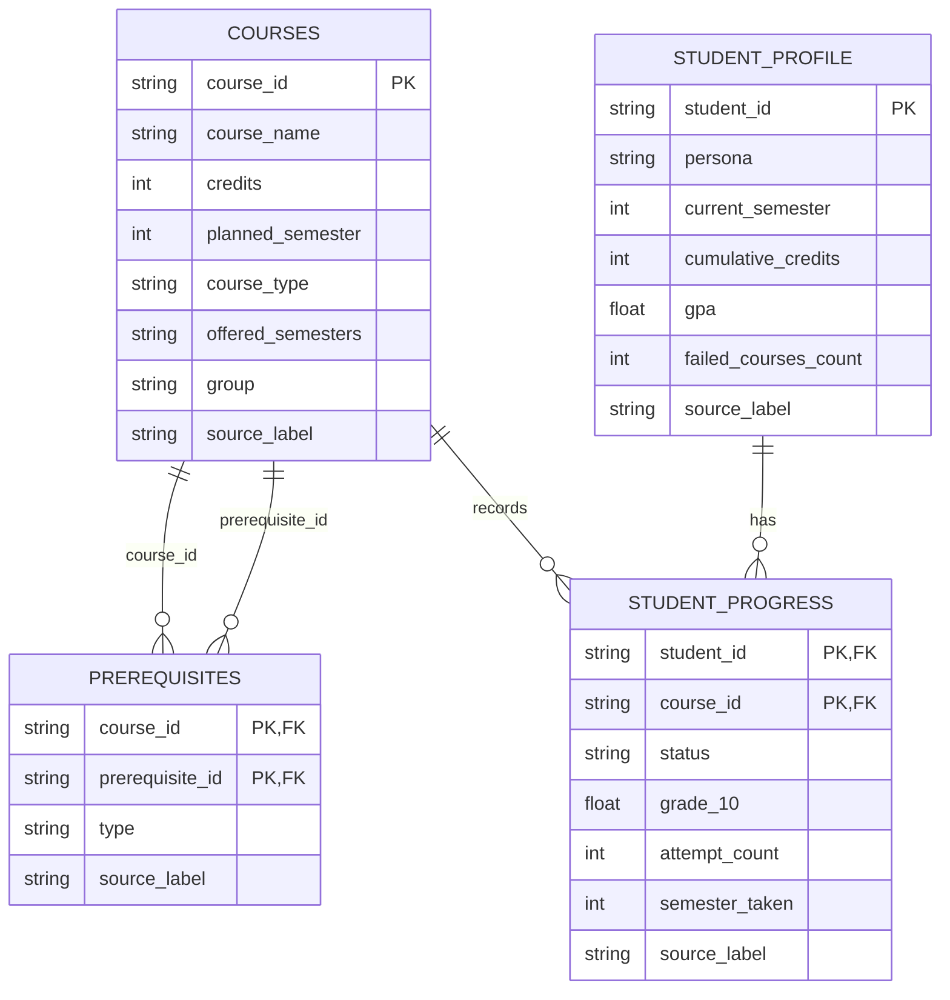

# ER dữ liệu tối ưu hóa — SIMULATED

## Khóa và ràng buộc

- `courses`: PK `course_id`.
- `prerequisites`: PK ghép (`course_id`, `prerequisite_id`); cả hai là FK tới `courses.course_id`.
- `student_profile`: PK `student_id`.
- `student_progress`: PK ghép (`student_id`, `course_id`); FK `student_id` tới `student_profile.student_id`, FK `course_id` tới `courses.course_id`.
- Tất cả các bảng trong sơ đồ là **SIMULATED**. CSV hiện thực hóa khóa bằng cột định danh; việc cưỡng chế FK/PK được kiểm tra bởi script, vì CSV không tự thực thi ràng buộc quan hệ.
