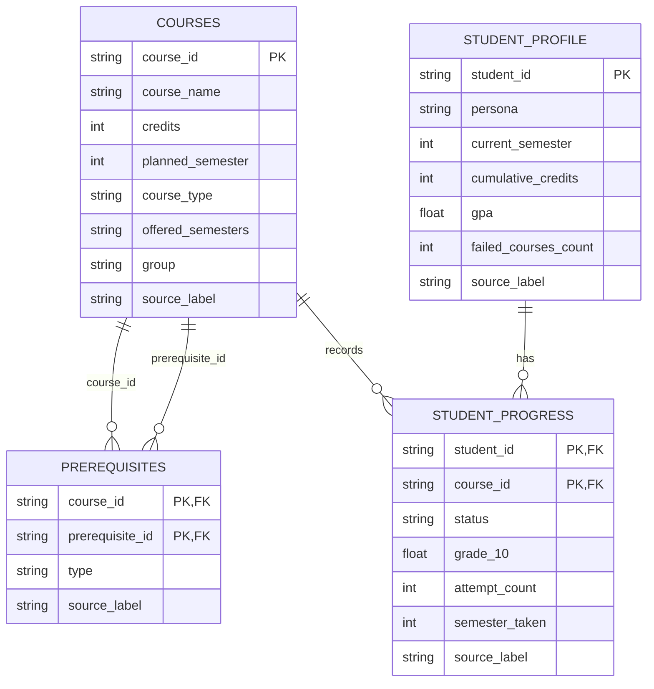

# Báo cáo giai đoạn 1 — Hệ hỗ trợ ra quyết định cảnh báo rủi ro học vụ và tối ưu hóa lộ trình tích lũy tín chỉ

> **Nhãn dữ liệu dùng trong toàn báo cáo:**
> - **REAL (UCI-697):** số liệu lấy trực tiếp từ bộ dữ liệu UCI-697.
> - **SIMULATED:** chương trình đào tạo, học phần, tiến độ và persona do nhóm tự dựng để thử schema/thuật toán, **không phải** CTĐT chính thức của Trường ĐH Nha Trang.
> - **GIẢ ĐỊNH:** tham số chính sách/kịch bản chưa được kiểm chứng (λ, độ khó, học lại, β, γ, ngưỡng cảnh báo…).
>
> **Phạm vi (cập nhật 2026-11-14):** khảo sát dữ liệu, **benchmark ML** (LR/RF/LightGBM; 3 lớp và nhị phân; train–validation–test, CV, calibration/threshold trên validation), rule engine, ILP, **Monte Carlo 1.000 lượt/sinh viên/chiến lược** so với B1–B3, và **UI Streamlit 4 tab** có SHAP. Các mô hình vẫn là baseline tái lập trên **REAL (UCI-697)**, chưa phải mô hình triển khai tại NTU; persona/kết quả mô phỏng **không** là bằng chứng hiệu quả thực tế.

## 0. Tóm tắt điều hành

Đề xuất đề tài “Hệ hỗ trợ ra quyết định cảnh báo rủi ro học tập và tối ưu hóa lộ trình tích lũy tín chỉ sinh viên” theo kiến trúc nối tiếp:

1. ML cảnh báo nguy cơ bỏ học từ đặc trưng có sẵn tại T1 (cuối HK1, trước đăng ký HK2).
2. Rule engine cảnh báo học vụ và xác định môn đủ điều kiện.
3. Tối ưu kế hoạch học phần có ràng buộc tín chỉ/tiên quyết/rủi ro (ILP).
4. Mô phỏng nhiều kỳ và so sánh với phương án đăng ký thông thường.

ML cảnh báo bỏ học và cảnh báo học vụ theo GPA/tiến độ là **hai bài toán riêng**, không gộp đầu ra.

Khảo sát **REAL (UCI-697)** có 4.424 sinh viên, 37 thuộc tính, không thiếu/trùng toàn dòng. UCI không có dữ liệu cấp học phần, số tín chỉ từng môn hay CTĐT; nhóm đã dựng catalogue 48 môn/128 tín chỉ **SIMULATED** để thử schema và logic. Xác suất Dropout và tỷ lệ đạt HK2 chỉ là kết quả exploratory trên dữ liệu Bồ Đào Nha; áp vào persona mô phỏng chỉ kiểm tra logic, không kiểm chứng độ chính xác tại NTU.

Tải HK2 trong dữ liệu quan sát không cho bằng chứng nhất quán về quan hệ giảm pass-rate trong cùng tầng HK1. Vì vậy không dùng counterfactual đổi số môn đăng ký làm phương pháp quyết định. Baseline pass-rate đề xuất là **M3′ theo tầng năng lực HK1, gộp mọi mức tải**; ảnh hưởng tải/độ khó/học lại chỉ hiển thị như tham số **GIẢ ĐỊNH kịch bản** độ nhạy.

Prototype PuLP/HiGHS xác nhận mô hình nhỏ có nghiệm khác nhau theo persona/ngân sách; ràng buộc rủi ro có thể làm một số persona không khả thi, và chuỗi dự phòng hiện trả `best_effort` có cờ thay vì lỗi rỗng. Đây là kiểm tra logic/công thức, không phải hiệu quả hệ thống.

**Trạng thái (2026-11-14):**

- **Đã xong:** A/B (dữ liệu, CTĐT SIMULATED, validator), C (benchmark ML LR/RF/LightGBM 3 lớp + nhị phân, CV, calibration/threshold trên validation, SHAP), D (rule engine + sửa lỗi song hành, ILP + độ nhạy β/γ/λ, Monte Carlo 7 persona × 4 chiến lược, UI 4 tab), bộ 25 unit/smoke test.
- **Còn phụ thuộc bên ngoài:** CTĐT và quy chế chính thức của NTU; dữ liệu NTU được phê duyệt để đánh giá domain shift; duyệt nhãn/mốc T1 và cách dùng P(Dropout).
- **Kết luận trung thực:** trên dữ liệu UCI-697 và CTĐT SIMULATED, ILP giảm số môn trượt kỳ vọng so với B1/B2/B3 trong mô phỏng, nhưng **không** vượt B1 về tỷ lệ tốt nghiệp đúng hạn và không có bằng chứng hiệu quả tại NTU. Báo cáo không khẳng định mô hình tốt hơn baseline.

## 1. Nguồn dữ liệu, mốc T1 và kiểm soát leakage

### 1.1. Nguồn và chất lượng

- **REAL (UCI-697):** [Predict Students' Dropout and Academic Success](https://archive.ics.uci.edu/dataset/697/predict+students+dropout+and+academic+success), UCI ID 697.
- Tệp raw giữ nguyên tại `data/raw/uci_697/data.csv`; SHA-256 khớp tệp tải từ UCI: `3EF126DE5CEFFF26EB11FBB4237F1A1401CB64B488E2F1D598C23CEDEB4C45AE`.
- Kết quả EDA: **4.424 dòng × 37 thuộc tính**, không có giá trị thiếu, không có dòng trùng hoàn toàn; pandas đọc 29 cột số nguyên, 7 cột số thực và một cột chuỗi (`Target`).
- Phân phối Target **REAL (UCI-697)**:

| Target | Số sinh viên | Tỷ lệ |
|---|---:|---:|
| Dropout | 1.421 | 32,12% |
| Enrolled | 794 | 17,95% |
| Graduate | 2.209 | 49,93% |

Target được quan sát cuối cùng, không phải nhãn thời gian thực độc lập. Đề xuất tạm bài toán 3 lớp; `Dropout` là lớp cảnh báo ưu tiên recall. Chưa chốt việc xem `Enrolled` là chưa hoàn tất hay trạng thái độc lập.

### 1.2. Nguồn CTĐT và ánh xạ UCI sang học phần mô phỏng

- Bài báo UCI trích dẫn: M. V. Martins, D. Tolledo, J. Machado, L. M. T. Baptista, V. Realinho, “Early prediction of student's performance in higher education: a case study” (2021), https://doi.org/10.1007/978-3-030-72657-7_16. Metadata được kiểm tra qua UCI API/Crossref; toàn văn nhà xuất bản không truy cập được để xác minh thêm timestamp theo từng trường.
- Cổng CTĐT chính thức NTU: https://ctdt.ntu.edu.vn (truy cập 2026-11-05). Trang là ứng dụng web; các API ngành/chương trình yêu cầu xác thực (401). Không thu được bảng CTĐT CNTT công khai có thể đọc được trong khảo sát này.
- Vì vậy toàn bộ `data/simulated/` là **SIMULATED**, dựng theo cấu trúc phổ biến để thử schema/thuật toán, **không phải CTĐT chính thức của Trường ĐH Nha Trang**. Cần thay/duyệt theo CTĐT và quy chế thật trước triển khai.

Giả định nối số học phần:

1. Tạm coi **1 curricular unit ≈ 1 học phần** khi tính số học phần đã đăng ký/đạt trong hồ sơ **SIMULATED**.
2. Không suy ra số tín chỉ UCI từ số unit. Tín chỉ của fixture lấy trực tiếp từ từng dòng `courses.csv`.
3. Không thể nối một unit UCI cụ thể với `course_id` mô phỏng; chỉ so sánh ở mức số lượng/tổng hợp.
4. CTĐT nháp có 8 kỳ, 40 học phần bắt buộc và 8 dòng tự chọn placeholder; tổng tín chỉ kiểm tra là tổng của 48 dòng. Mỗi placeholder đại diện một học phần tự chọn giả định được chọn, không phải tên môn thật; phân bổ placeholder theo kỳ chỉ là dữ liệu mẫu.

Giả định quy đổi điểm:

- `grade_10 = grade_20 / 2`, giới hạn đầu vào UCI ở `[0, 20]`, kết quả `[0, 10]`.
- `grade_4 = grade_10 × 0.4`, giới hạn kết quả `[0, 4]`.
- Chiều ngược dùng cho cột `Curricular units 1st sem (grade)` của hồ sơ fixture: `grade_20 = grade_10 × 2`.

Đây là **giả định tạm**, không có căn cứ trong tài liệu UCI để khẳng định tương đương thang điểm/quy chế Việt Nam. Phép chia 2 chỉ dùng để tạo đặc trưng ML trong fixture; **không dùng để suy ngưỡng đạt học phần của NTU**. Ngưỡng đạt, quy đổi chính thức và GPA cần xác nhận với giảng viên/NTU. Các giá trị `grade_10` của `student_progress.csv` được sinh để phục vụ kiểm thử, không phải kết quả học tập thật.

### 1.3. Thời điểm có sẵn và leakage

Từ điển thuộc tính đầy đủ lưu tại `reports/data_dictionary.csv`, gồm tên, kiểu, ý nghĩa, nhóm, `available_at`, cờ leakage và lý do. Feature cơ sở ở mốc **T1: cuối HK1, trước đăng ký HK2** chỉ nhận thuộc tính `T0` hoặc `T1_known`.

- Đầu vào/tuyển sinh: nhân khẩu học, phương thức/ngành tuyển sinh, học vấn đầu vào, điểm xét tuyển.
- Học thuật HK1: credited, enrolled, evaluations, approved, grade, without evaluations; quan sát sau khi có kết quả HK1.
- HK2: credited/enrolled là `T1_decision`, chỉ dùng phân tích phương án; evaluations/approved/grade/without evaluations là post-outcome và không vào feature T1.
- `Debtor`, `Tuition fees up to date`, `Scholarship holder`, `Unemployment rate`, `Inflation rate`, `GDP`: timestamp theo thuộc tính chưa xác minh, loại khỏi feature cơ sở.

Một số tương quan mô tả Pearson với Dropout (không nhân quả) **REAL (UCI-697)**:

| Thuộc tính | r | Quyết định thời điểm |
|---|---:|---|
| HK2 grade | -0,5718 | hậu nghiệm, leakage tại T1 |
| HK2 approved | -0,5695 | hậu nghiệm, leakage tại T1 |
| HK1 grade | -0,4807 | dùng sau HK1 |
| HK1 approved | -0,4791 | dùng sau HK1 |
| Age at enrollment | 0,2542 | có ở đầu vào |
| Debtor | 0,2294 | timestamp chưa xác minh, loại khỏi cơ sở |

UCI có sáu chỉ số học thuật cho mỗi học kỳ: curricular units credited/enrolled/evaluations/approved/grade/without evaluations. Trung bình `enrolled` HK1 của Graduate là 6,670 so với 5,821 của Dropout **(REAL)**; đây chỉ là tương quan. Không suy diễn đăng ký nhiều gây giảm hoặc tăng nguy cơ. Số unit UCI không phải tín chỉ NTU.

### 1.4. Đặc trưng ML có thể/không thể tạo từ hồ sơ mô phỏng

**Có thể tạo ở mức fixture:**

- Sáu trường HK1: `Curricular units 1st sem (enrolled)` và `approved` đếm từ các hàng fixture; `credited` mặc định 0 khi chưa mô phỏng công nhận tín chỉ; `grade` lấy trung bình điểm đạt trên thang 10 rồi nhân 2; `evaluations` và `without evaluations` đếm theo trạng thái fixture.
- `Age at enrollment` và các trường đầu vào khác được ghi thành giá trị **SIMULATED** theo kịch bản. Mã ngành tuyển sinh, học vấn/quốc tịch/nghề nghiệp phụ huynh dùng mã giống hình thức UCI chỉ để thử schema.

**Chưa thể tạo hợp lệ/không dùng ở bộ đặc trưng T1 cơ sở:**

- `Debtor`, `Tuition fees up to date`, `Scholarship holder`, `Unemployment rate`, `Inflation rate`, `GDP`: chưa xác định timestamp ⇒ gắn trạng thái **chưa xác minh**, không đưa vào bộ đặc trưng T1 cơ sở.
- `Target`: không tạo nhãn giả cho persona, vì không có kết quả cuối kỳ thực nghiệm.
- `Curricular units 2nd sem (credited)` và `(enrolled)`: là biến quyết định/đầu vào mô phỏng phương án tại T1, không phải feature đã quan sát cho ML.

### 1.5. Kết quả EDA và đề xuất nhãn

Target mất cân bằng; phải báo cáo precision, recall, F1 lớp Dropout và confusion matrix, không dùng accuracy làm tiêu chí duy nhất. **Đã chạy benchmark đầy đủ** LR/RF/LightGBM cho cả 3 lớp và nhị phân, gồm PR-AUC, Brier, calibration và SHAP — xem §3.6–§3.7. LightGBM được dùng thay XGBoost vì hỗ trợ sẵn trong môi trường hiện tại và cùng họ gradient boosting. Đây vẫn là baseline tái lập, chưa phải mô hình triển khai. Cần xác nhận nhãn ba lớp/ý nghĩa `Enrolled` và mốc T1 ở mục 11.

## 2. CTĐT mô phỏng, tiến độ và persona

### 2.1. Schema dữ liệu



Khóa và ràng buộc:

- `courses`: PK `course_id`.
- `prerequisites`: PK ghép (`course_id`, `prerequisite_id`); cả hai là FK tới `courses.course_id`.
- `student_profile`: PK `student_id`.
- `student_progress`: PK ghép (`student_id`, `course_id`); FK `student_id` tới `student_profile.student_id`, FK `course_id` tới `courses.course_id`.
- Tất cả bảng trong sơ đồ là **SIMULATED**. CSV hiện thực hóa khóa bằng cột định danh; việc cưỡng chế FK/PK được kiểm tra bởi script, vì CSV không tự thực thi ràng buộc quan hệ.

### 2.2. Catalogue và kiểm tra

Catalogue **SIMULATED** có 48 môn (40 bắt buộc, 8 elective placeholder), 8 học kỳ và 128 tín chỉ; tín chỉ theo kỳ HK1–HK8 lần lượt 16, 15, 16, 17, 16, 16, 16, 16. Mọi giới hạn hiện tại là fixture theo cấu hình, không phải quy chế.

Kết quả chạy lại `python src/data/validate_curriculum.py` trên dữ liệu hiện hành — **nguyên văn**, nhãn **SIMULATED**:

```text
Curriculum validation — SIMULATED
PASS: Mã học phần duy nhất.
PASS: Số học phần 48 nằm trong khoảng 40–50.
PASS: Có đủ học kỳ dự kiến 1–8.
PASS: Mọi học phần được gắn nhãn SIMULATED.
PASS: Mọi course_id và prerequisite_id trong quan hệ tiên quyết đều tồn tại.
PASS: Đồ thị tiên quyết là DAG, không có chu trình.
PASS: Thứ tự học kỳ phù hợp loại quan hệ tiên quyết/học trước/song hành.
PASS: Loại quan hệ chỉ gồm 'tiên quyết', 'học trước' hoặc 'song hành'.
PASS: Mỗi học phần có ít nhất một học kỳ mở, gồm học kỳ dự kiến.
PASS: Tổng tín chỉ catalogue 128 nằm trong khoảng 120–140.
PASS: Tín chỉ từng học kỳ nằm trong khoảng cấu hình 12–18.
Tín chỉ theo học kỳ — SIMULATED: HK1=16, HK2=15, HK3=16, HK4=17, HK5=16, HK6=16, HK7=16, HK8=16
KẾT LUẬN: PASS (128 tín chỉ, 48 học phần)
```

**Đối chiếu số tiêu chí (khắc phục lệch 14 vs 11):** output trên có **đúng 11 dòng `PASS`**, tương ứng 11 tiêu chí kiểm tra; kết luận tổng hợp là 128 tín chỉ / 48 học phần. Con số “14 tiêu chí” trong bản báo cáo Word cũ **không khớp** với validator hiện hành và không tái lập được — bản Word cần sửa thành 11 hoặc bổ sung 3 tiêu chí mới vào code trước khi tăng số. Báo cáo này dùng **11** làm con số chuẩn; danh sách tiêu chí đầy đủ nằm trong `reports/curriculum_validation.txt` và mã nguồn `src/data/validate_curriculum.py`.

### 2.3. Persona

Persona được tạo từ medoid vector feature REAL thuộc từng tầng HK1 rồi gắn nhãn SIMULATED; S002 được kiểm tra thuộc tầng Trung bình. Các ca học lại, môn chặn chuỗi, gần tốt nghiệp và hoàn tất tín chỉ dùng để sanity-check rule engine. Persona không đủ môn để lấp tải được giữ nguyên, không thêm môn trái prerequisite. Toàn bộ điểm/course graph/lịch mở còn phải thay bằng dữ liệu CTĐT chính thức.

### 2.4. Hạn chế: domain shift

Mô hình/quan sát học từ **REAL (UCI-697)** tại các cơ sở Bồ Đào Nha; hồ sơ và chương trình hiện tại là **SIMULATED**. Áp mô hình UCI lên persona chỉ kiểm tra luồng dữ liệu, thứ tự tương đối và logic hệ thống, **không** xác nhận độ chính xác cho NTU. Cần dữ liệu NTU được phê duyệt và đánh giá độc lập trước khi dùng thực tế.

## 3. Hai mục tiêu dự báo, mô hình serving và benchmark

### 3.1. Tách hai mục tiêu

Hai đại lượng đích **không được gộp**:

1. `P(Dropout | T1)`: xác suất bỏ học cấp sinh viên, do bộ phân loại dùng feature `available_at ∈ {T0, T1_known}` ước lượng. Chỉ dùng để cảnh báo/ràng buộc ở rule engine; **không nhân trực tiếp** vào xác suất đạt môn.
2. `pass_rate_2 = approved_2nd / enrolled_2nd`: tỷ lệ đạt curricular unit HK2 hậu nghiệm. Chỉ xác định khi `enrolled_2 > 0`; dùng để xây nền ước lượng pass. `without evaluations` vẫn ở mẫu số enrollment, không được tính là approved, và được báo cáo riêng.

`enrolled_2` là `T1_decision`: chỉ dùng phân tầng/diagnostic C.3/M1; không đưa vào feature model P(Dropout) hay pass-rate tại T1. Sáu trường chưa rõ timestamp và mọi outcome HK2 đều bị loại khỏi feature cơ sở.

### 3.2. Mô hình cơ sở exploratory

Logistic Regression ba lớp dùng 24 feature T0 + T1-known, train/test tách riêng 80/20 có phân tầng; train đánh giá bằng Stratified 5-fold CV. Random Forest Regressor ước lượng pass-rate trên nhóm có `enrolled_2 > 0` (KFold 5-fold). Đây là mô hình serving trong artifact `artifacts/risk_bundle.joblib` để UI chạy end-to-end, **không phải** mô hình cuối. **Nguồn số liệu so sánh chính thức là benchmark 60/20/20 ở §3.6** (có validation riêng cho calibration/threshold); các số 80/20 dưới đây chỉ mô tả artifact đang phục vụ. Seed `20261105`.

**REAL (UCI-697), exploratory**

| Chỉ số | Giá trị |
|---|---:|
| Dropout: CV accuracy / macro-F1 / F1 | 0,714046 / 0,616392 / 0,709335 |
| Dropout: holdout precision / recall / F1 | 0,701031 / 0,718310 / 0,709565 |
| Dropout: holdout Brier one-vs-rest | 0,121147 |
| Confusion matrix (hàng/thứ tự nhãn: Dropout, Enrolled, Graduate) | `[[204,20,60],[48,46,65],[39,24,379]]` |
| Pass-rate: số sinh viên có `enrolled_2 > 0` / không đăng ký | 4.244 / 180 |
| Pass-rate: CV MAE / RMSE | 0,120090 / 0,183969 |
| Pass-rate: holdout MAE / RMSE | 0,124046 / 0,193556 |

`enrolled_2 = 0` không được tự gán nhãn “bỏ học” hay pass-rate bằng 0: tỷ lệ Dropout quan sát trong nhóm này là **42,7778% (REAL)**, nên nhóm vẫn có thể thuộc nhiều Target. Hệ thống giữ trạng thái không đăng ký riêng; mô hình Dropout dự báo riêng, còn pass-rate không định nghĩa ở mẫu số bằng 0.

### 3.3. Hiệu chuẩn pass-rate

Bảng dưới là calibration theo decile dự báo trên holdout **REAL (UCI-697)**. Mỗi decile có 84–85 sinh viên.

| Decile | n | Trung bình dự báo | Trung bình thực tế |
|---:|---:|---:|---:|
| 0 | 85 | 0,009787 | 0,012381 |
| 1 | 85 | 0,208263 | 0,237507 |
| 2 | 85 | 0,518382 | 0,531022 |
| 3 | 85 | 0,709199 | 0,673686 |
| 4 | 85 | 0,792052 | 0,788403 |
| 5 | 84 | 0,844018 | 0,853117 |
| 6 | 85 | 0,876832 | 0,877344 |
| 7 | 85 | 0,917449 | 0,912353 |
| 8 | 85 | 0,954386 | 0,943961 |
| 9 | 85 | 0,982630 | 0,966373 |

Isotonic được fit trên dự đoán OOF của train, đánh giá trên cùng holdout: MAE/RMSE thô **0,124046/0,193556**, isotonic **0,124389/0,195836**; MAE calibration decile **0,012507** so với **0,015273**. **Không áp dụng isotonic** cho pass-rate trong exploratory này vì không cải thiện các chỉ số holdout đã định trước; đây chưa phải kết luận hiệu chuẩn cuối.

### 3.4. Kiểm định tải học quan sát, không nhân quả

Năng lực nền phân tầng theo tỷ lệ đạt HK1; tải HK2 chia 1–5, 6–7, 8+ curricular units. Pass rate là pooled `approved_2 / enrolled_2`; nhóm enrollment bằng 0 giữ riêng. Nhãn **REAL (UCI-697)**:

| Tầng HK1 | Tải HK2 | Sinh viên | Pass rate HK2 | Tỷ lệ Dropout |
|---|---:|---:|---:|---:|
| Thấp | 0 | 180 | Không xác định | 0,427778 |
| Thấp | 1–5 | 578 | 0,286415 | 0,697232 |
| Thấp | 6–7 | 495 | 0,190445 | 0,828283 |
| Thấp | 8+ | 96 | 0,327546 | 0,729167 |
| Trung bình | 1–5 | 197 | 0,755601 | 0,213198 |
| Trung bình | 6–7 | 720 | 0,729621 | 0,275000 |
| Trung bình | 8+ | 430 | 0,841799 | 0,162791 |
| Cao | 1–5 | 307 | 0,915243 | 0,107492 |
| Cao | 6–7 | 1.002 | 0,914521 | 0,092814 |
| Cao | 8+ | 419 | 0,966438 | 0,059666 |

Hồi quy Logistic nhị phân mô tả `Dropout` có kiểm soát tỷ lệ đạt HK1, số môn HK1 đăng ký/đạt, điểm HK1 và tuổi cho OR quan sát **1,000469** mỗi curricular unit HK2 tăng thêm. Trong từng tầng, dấu không đồng nhất: tải 6–7 thấp hơn tải 1–5 ở tầng Thấp/Trung bình nhưng gần như không đổi ở tầng Cao; 8+ lại có pass rate cao hơn ở cả ba tầng so với 6–7. Kết luận theo yêu cầu là **(c) dữ liệu quan sát chưa đủ để kết luận tải cao làm giảm tỷ lệ đạt**; không có bằng chứng nhất quán theo tầng về quan hệ đơn điệu.

Đây là quan sát, không có ngẫu nhiên hóa; chọn tải có thể phụ thuộc năng lực/hoàn cảnh chưa đo và không biết ai bị buộc đăng ký nhiều. Không trình bày OR hoặc bảng trên như hiệu ứng nhân quả.

### 3.5. Đối chiếu M1 với hồi quy C.3

M1 diagnostic được fit trên cùng 24 feature T0 + T1-known **cộng** `enrolled_2` và cùng train/holdout split. Với các feature giữ cố định:

- Binary Logistic Regression (`Dropout` so với phần còn lại): OR của `enrolled_2` **1,314506/unit**.
- Logistic ba lớp: xác suất Dropout tại vector đại diện tăng từ **0,057021** khi `enrolled_2=1` lên **0,238071** khi `enrolled_2=12`; OR hiệu dụng qua hai điểm là **1,161026/unit**.
- C.3 observational OR **1,000469** (kiểm soát ít biến hơn, không cùng mô hình đặc trưng/ước lượng).

Hai OR M1 không trùng nhau vì binary Logistic và xác suất một lớp trong softmax ba lớp là các hàm khác nhau; OR ba lớp là hiệu dụng qua hai mức counterfactual, không phải hệ số tuyến tính. Ba con số không cùng một estimand. M1 tạo xu hướng rủi ro tăng khi tăng tải ở hai cách biểu diễn, nhưng thay `T1_decision` trong mô hình không phải can thiệp hợp lệ và có thể ngoại suy. **M1 bị loại làm phương pháp quyết định**, không chọn con số thuận lợi và không diễn giải chiều này thành nhân quả.

### 3.6. Benchmark mô hình phân loại (hoàn tất)

**Giao thức không rò rỉ test** (áp dụng cho cả 6 cấu hình):

1. Chia stratified **60/20/20** trên nhãn 3 lớp: train 2.654 / validation 885 / test 885.
2. **5-fold stratified CV chỉ trên train** để so sánh mô hình và xem độ phân tán.
3. **Isotonic calibration fit trên dự đoán validation**; **ngưỡng quyết định chọn trên validation** theo macro-F1 (tie-break F1 Dropout). Test **không** tham gia chọn ngưỡng/calibration.
4. Test được chấm **một lần** với calibration + threshold đã đóng băng.

**Kết quả test REAL (UCI-697)**, Dropout là lớp dương cho PR-AUC/ROC-AUC:

| Bài toán | Mô hình | Acc | Macro-F1 | Dropout P | Dropout R | Dropout F1 | PR-AUC | ROC-AUC | Brier | Ngưỡng |
|---|---|---:|---:|---:|---:|---:|---:|---:|---:|---:|
| 3 lớp | Logistic Regression | 0,6859 | **0,6437** | 0,7360 | 0,6479 | **0,6891** | **0,7743** | 0,8598 | 0,1317 | 0,360 |
| 3 lớp | Random Forest | 0,6655 | 0,6110 | 0,6852 | 0,6514 | 0,6679 | 0,7192 | 0,8414 | 0,1485 | 0,465 |
| 3 lớp | LightGBM | 0,6768 | 0,6115 | **0,7713** | 0,5106 | 0,6144 | 0,7390 | 0,8429 | 0,1446 | 0,505 |
| Nhị phân | Logistic Regression | **0,8079** | **0,7780** | 0,7065 | 0,6866 | **0,6964** | **0,7830** | **0,8638** | **0,1293** | 0,405 |
| Nhị phân | Random Forest | 0,7864 | 0,7520 | 0,6753 | 0,6444 | 0,6595 | 0,7163 | 0,8405 | 0,1474 | 0,405 |
| Nhị phân | LightGBM | 0,8000 | 0,7654 | 0,7050 | 0,6479 | 0,6752 | 0,7302 | 0,8342 | 0,1451 | 0,370 |

CV trên train (trung bình ± độ lệch chuẩn, macro-F1): 3 lớp LR 0,6315 ± 0,0179; RF 0,6357 ± 0,0203; LightGBM 0,6229 ± 0,0196. Nhị phân LR 0,7921 ± 0,0100; RF 0,7965 ± 0,0169; LightGBM 0,7882 ± 0,0090. Test ECE (3 lớp): LR 0,0352; RF 0,0595; LightGBM 0,0458 — LR hiệu chuẩn tốt nhất.

**Per-class trên test (3 lớp):**

| Mô hình | Lớp | Precision | Recall | F1 | Support |
|---|---|---:|---:|---:|---:|
| LR | Dropout | 0,736 | 0,648 | 0,689 | 284 |
| LR | Enrolled | 0,387 | 0,547 | 0,453 | 159 |
| LR | Graduate | 0,820 | 0,760 | 0,789 | 442 |
| RF | Dropout | 0,685 | 0,651 | 0,668 | 284 |
| RF | Enrolled | 0,362 | 0,428 | 0,392 | 159 |
| RF | Graduate | 0,787 | 0,760 | 0,773 | 442 |
| LightGBM | Dropout | 0,771 | 0,511 | 0,614 | 284 |
| LightGBM | Enrolled | 0,359 | 0,465 | 0,405 | 159 |
| LightGBM | Graduate | 0,774 | 0,860 | 0,815 | 442 |

**Confusion matrix 3 lớp, LR** (hàng thật, cột dự đoán; Dropout/Enrolled/Graduate): `[[184, 70, 30], [28, 87, 44], [38, 68, 336]]`. Nhị phân LR: `[[195, 89], [81, 520]]`.

**Phân tích Enrolled recall thấp:** báo cáo trước ghi recall Enrolled **≈28,9% (46/159)** trên split 80/20 không có validation riêng. Benchmark mới — calibration isotonic và threshold chọn trên validation — nâng LR lên **0,547** (28 Enrolled bị đoán Dropout, 44 đoán Graduate); RF 0,428 (44/47); LightGBM 0,465 (30/55). Mức tăng đến từ ngưỡng được chọn đúng tập và calibration, không phải từ việc “tối ưu” trên test. Recall vẫn thấp vì **hệ quả của định nghĩa nhãn**: `Enrolled` là trạng thái quan sát tại T1, không phải kết cục cuối, nằm giữa hai cực Dropout/Graduate nên mô hình dễ “kéo” về một phía. Vì vậy recall Enrolled **không** được dùng làm chỉ số an toàn; cảnh báo chỉ dựa trên lớp Dropout và luôn kèm cố vấn.

**So sánh 3 lớp vs nhị phân:** nhị phân cho accuracy/macro-F1/PR-AUC cao hơn rõ rệt (LR 0,8079/0,7780/0,7830 so với 0,6859/0,6437/0,7743) vì gộp Enrolled + Graduate thành Non-Dropout, nhưng **mất khả năng phân biệt Enrolled** — thông tin cần cho tư vấn học vụ. Quyết định: **3 lớp là mô hình chính cho dashboard** (giữ Enrolled như lớp riêng); nhị phân chỉ là điểm phụ “nguy cơ không tốt nghiệp”. Không chọn mô hình theo con số thuận lợi: LR được giữ vì macro-F1/PR-AUC/Brier tốt nhất trong nhóm 3 lớp và giải thích được bằng SHAP tuyến tính. LightGBM có precision Dropout cao nhất nhưng recall thấp (0,511), không phù hợp mục tiêu cảnh báo ưu tiên recall.

### 3.7. SHAP: giải thích cục bộ và toàn cục (không nhân quả)

Benchmark tính SHAP trên test; UI dùng `LinearExplainer` cho pipeline LR serving với nền **REAL (UCI-697)** 120 dòng. Top feature theo mean |SHAP| của LR: `Curricular units 1st sem (approved)` 1,327; `(enrolled)` 0,465; `Age at enrollment` 0,234; `(grade)` 0,179; `(credited)` 0,153. LightGBM cho thứ tự tương tự ở ba vị trí đầu (approved 1,099; age 0,314; grade 0,270) nhưng phân bố đều hơn sang điểm tuyển sinh và nghề nghiệp phụ huynh.

Kiểm tra tính cộng: với S003, tổng SHAP 4,0743 + base value 0,32457 = logit 4,3988 khớp dự đoán của mô hình. Trên UI, mỗi hồ sơ có bảng top-10 feature kèm dấu đóng góp; ví dụ `approved` cao làm giảm logit Dropout, còn nhóm hồ sơ yếu làm tăng.

**Cảnh báo bắt buộc:** SHAP mô tả **mức đóng góp của feature vào dự đoán của mô hình**, chịu ảnh hưởng của tương quan giữa feature; **không phải quan hệ nhân quả** và không hàm ý can thiệp vào feature sẽ thay đổi nguy cơ. Câu này được ghi trong cả bảng CSV, ảnh SHAP và UI.

## 4. Chuyển rủi ro tổng thể thành xác suất từng môn

### 4.1. So sánh phương pháp

| Phương pháp | Giả định, ưu/nhược và kiểm chứng | Quyết định |
|---|---|---|
| M1: thay `enrolled_2` trong mô hình Dropout | `T1_decision` không phải feature đã quan sát; phản ánh liên hệ và ngoại suy, không nhận dạng tác động. Chiều counterfactual tăng Dropout; đối chiếu với phân tầng mục 3.4, không dùng ra quyết định. | Loại làm chính. |
| M2: hai tầng tham số | `p_i=clip(p_student × f_difficulty(i) × g_load(plan) × r_retake(i),0,1)`. Factor độ khó từ median grade_10 theo nhóm SIMULATED / median chung, cắt quantile 10–90; fixture 0,9083–1,1597. `g_load=exp(−λ×max(0,units−6))`; `r_retake` lưới {0,9;1,0;1,1}. Dễ giải thích, nhưng môn/độ khó/tải không được UCI nhận dạng. | Độ nhạy; λ={0;0,1;0,3} và factor là **GIẢ ĐỊNH**. |
| M3: tầng HK1 × band tải | Tỷ lệ pooled REAL trong ô; tầng Trung bình 8+ là 0,841799 so với 1–5 là 0,755601. Có thể bị selection bias. | Chỉ minh chứng thiên lệch chọn tải. |
| M3′: tầng HK1, gộp mọi band tải | `p_student=Σapproved_2/Σenrolled_2` trong tầng HK1; không đưa selection-by-load vào xác suất nền. | **Baseline chính**; hiệu ứng tải chỉ vào qua `g_load` của M2. |

M2 ước lượng `p_student` bằng RF pass-rate từ T0 + T1-known, **không phải** `P(Dropout)`. `units = total_credits / mean(course.credits)` trên catalogue SIMULATED; mean hiện tại 128/48 = **2,6667** tín chỉ/môn. 12/15/18 tín chỉ tương ứng 4,5/5,625/6,75 unit; quy tắc half-up `floor(x+0.5)` cho 5/6/7, không dùng bankers rounding. `g_load` dùng số unit tương đương chưa làm tròn trong `plan_risk`; prototype ILP dùng unit làm tròn từ trần tải kịch bản để giữ mô hình tuyến tính. `median_units_REAL=6`.

### 4.2. Baseline M3′

**REAL (UCI-697):** Thấp 1.683/6.776 = **0,248377** (1.169 sinh viên có đăng ký); Trung bình 7.349/9.429 = **0,779404** (1.347); Cao 10.592/11.366 = **0,931902** (1.728). Nếu strata dưới ngưỡng tối thiểu 30 sinh viên, gộp dần với tầng liền kề theo thứ tự Thấp–Trung bình–Cao, tính lại tỷ lệ từ tổng approved/enrolled; nếu vẫn không đủ mẫu trả “không ước lượng được”, không tự thay bằng 0.

M3′ gồm cả sinh viên sau đó có Target=Dropout; đây là pass-rate quan sát của các unit đã đăng ký, không phải xác suất pass có điều kiện sống sót. Loại họ sau khi biết Target là phân tích hậu nghiệm survivor-only:

| Tầng HK1 | M3′ mọi Target | M3′ chỉ Target≠Dropout | Mẫu non-Dropout có enrollment |
|---|---:|---:|---:|
| Thấp | 0,248377 | 0,564428 | 286 |
| Trung bình | 0,779404 | 0,833310 | 1.037 |
| Cao | 0,931902 | 0,946581 | 1.577 |

Đối chiếu **SIMULATED persona** (vector feature REAL-derived): S003/yếu có M3′=0,248377, rate tầng non-Dropout=0,564428 và RF dự báo cá thể=0,048941; S002/trung bình lần lượt 0,779404, 0,833310, 0,593345. Mức 0,7457 nêu trước đây không tái lập được bằng phép pooling hiện hành; không thay số để khớp ví dụ. Mặc định dùng M3′ làm baseline ổn định, không điều kiện hóa theo Dropout hậu nghiệm; RF và non-Dropout table chỉ là đối chiếu/độ nhạy. Chế độ mô phỏng hazard bỏ học, nếu dùng, tách riêng ở mục 8.

### 4.3. Đặc tả `plan_risk`

Hàm `plan_risk(student_id, plan, p_student_pass, ...)` trong `src/optimize/plan_risk.py` nhận danh sách môn có `course_id`, `credits`, nhóm/độ khó, trạng thái và số lần học; xác suất nền **M3′ hoặc RF pass-rate** phải được ghi nguồn rõ. Trả về:

- `p_pass_by_course`
- `expected_credits_passed = Σ credits_i × p_i`
- `expected_failed_courses = Σ (1 − p_i)`
- `prob_at_least_k_fail` cho k=1,2
- `plan_risk_index = 100 × (1 − expected_credits_passed / Σcredits)`
- tổng tín chỉ/unit

Plan rỗng trả `None`.

Với `p_i` và giả định độc lập:

```text
E[tín chỉ đạt] = Σ credits_i × p_i
E[số môn trượt] = Σ (1 − p_i)
P(≥1 trượt) = 1 − Π p_i
P(≥2 trượt) = 1 − Π p_i − Σ_i [(1 − p_i) × Π_(j≠i) p_j]
```

Độc lập là giả định, không phải dữ kiện; năng lực chung có thể làm kết quả môn tương quan. Mapping credit → curricular unit là xấp xỉ: chia tổng tín chỉ theo trung bình tín chỉ/môn SIMULATED; làm tròn half-up để phân band UCI, đảm bảo đơn điệu. Không suy ra số tín chỉ chính thức từ UCI.

Môn học lại: trạng thái `failed`/`attempt_count>1` được gắn factor `r_retake` **GIẢ ĐỊNH** {0,9;1,0;1,1}; mặc định trung tâm 1,0, không giả định học lại chắc chắn tốt hơn. `P(Dropout)` không đi vào `p_i`; warning dùng để hiển thị/cố vấn, caps tín chỉ/Fmax là khuyến nghị mềm mặc định, không hard-enforce (`enforce_cap=false`).

### 4.4. Persona và độ nhạy

Persona **SIMULATED** lấy vector feature từ medoid hồ sơ **REAL** ở tầng HK1 tương ứng, sau đó gắn nhãn SIMULATED và dựng tiến độ CTĐT fixture. S002 được kiểm tra thuộc tầng **Trung bình**. Heuristic subset-sum lũy tiến chọn plan lớn hơn bằng cách giữ các môn đã chọn ở budget trước, rồi bổ sung môn chưa học/chưa đạt hợp lịch mở/prerequisite; không dùng ILP:

| Persona / tầng HK1 từ REAL | Budget tín chỉ | Thực chọn | M3′ `p_student` | Expected failures M3′ | Ghi chú (SIMULATED) |
|---|---:|---:|---:|---:|---|
| S001 / Cao | 12 | 12 | 0,931902 | 0,272391 | Đủ |
| S001 / Cao | 15 | 14 | 0,931902 | 0,340489 | Underfill |
| S001 / Cao | 18 | 18 | 0,931902 | 0,476685 | Đủ |
| S002 / Trung bình | 12 | 12 | 0,779404 | 0,882384 | Đủ |
| S002 / Trung bình | 15 | 14 | 0,779404 | 1,102980 | Underfill |
| S002 / Trung bình | 18 | 18 | 0,779404 | 1,544172 | Đủ |
| S003 / Thấp | 12 | 12 | 0,248377 | 3,006494 | Đủ |
| S003 / Thấp | 15 | 15 | 0,248377 | 3,758117 | Đủ |
| S003 / Thấp | 18 | 17 | 0,248377 | 4,509740 | Underfill |
| S005 / Trung bình | 12 | 12 | 0,779404 | 1,102980 | Đủ; môn nợ IT202 chặn chuỗi |
| S005 / Trung bình | 15 | 15 | 0,779404 | 1,323576 | Đủ |
| S005 / Trung bình | 18 | 15 | 0,779404 | 1,323576 | Không đủ môn đủ điều kiện |

Với nested plans, expected failures không giảm khi tăng tải; expected credits passed của persona yếu tăng chậm (M3′ đồng nhất xác suất nên không mô hình hóa bão hòa/giảm). S004 chỉ lấp 14/16 ở ngân sách 15/18; S005 lấp 15 ở budget 18; S006 chỉ còn 2 tín chỉ; S008 không còn môn tương lai. Đây là giới hạn của persona/đồ thị SIMULATED, không thêm môn trái prerequisite để giả tạo khả năng đăng ký.

**Độ nhạy M2 trên plan S003 12 tín chỉ (SIMULATED + GIẢ ĐỊNH):** λ {0;0,1;0,3} × difficulty {0,8;1,0;1,2} × retake {0,9;1,0;1,1} tạo khoảng **3,758010–3,845897 expected failures**, **0,462309–0,725971 expected credits passed** và plan-risk **93,950238–96,147426**. Đây là cực trị của lưới tham số, không phải khoảng tin cậy. `p_student` RF của S003 rất thấp (0,048941), nên đầu ra khác M3′ đáng kể. M3′ là baseline chính; khoảng này minh họa mức phụ thuộc giả định của M2.

## 5. Rule engine: cảnh báo học vụ và điều kiện đăng ký

`evaluate_student` trong `src/rules/rule_engine.py` tách hai loại quyết định:

- `academic_flags`: cảnh báo học vụ từ GPA, tín chỉ chậm tiến độ, môn chưa đạt; **không dùng ML**.
- `eligible_courses`: chưa đạt/chưa học, còn lượt học lại, được mở kỳ tới và thỏa quan hệ prerequisite:
  - `tiên quyết` yêu cầu đã đạt;
  - `học trước` yêu cầu đã học/đang học;
  - `song hành` cho phép nếu học phần kia đã hoàn tất/đang học hoặc cùng được chọn.
  - Được học vượt kỳ dự kiến nếu mở đúng kỳ và đủ prerequisite.
- `progress_stats`: tín chỉ tích lũy/còn thiếu, kỳ tối thiểu còn lại là max(cận dưới theo tín chỉ tối đa/kỳ, chuỗi prerequisite nghiêm ngặt dài nhất).
- `edge_case_flags`: đã đủ tín chỉ tốt nghiệp; không có môn đủ điều kiện; môn bắt buộc không mở kỳ tới; môn bắt buộc bị chặn bởi prerequisite.

### 5.1. Cảnh báo ≠ hạn chế tải

Hai ngưỡng warning được chọn trên 5-fold OOF train **REAL**, theo mục tiêu recall Dropout ≥0,98 và ≥0,90; giá trị 0,029362 và 0,138654, recall tương ứng 0,980651 và 0,900616:

| Tầng cảnh báo | Sinh viên | Tỷ lệ train OOF | Dropout thực tế | PPV trong tầng |
|---|---:|---:|---:|---:|
| Thấp | 450 | 12,72% | 4,89% | 4,89% |
| Trung bình | 1.166 | 32,95% | 7,80% | 7,80% |
| Cao | 1.923 | 54,34% | 53,25% | 53,25% |

Warning ưu tiên recall để hiển thị và đề nghị cố vấn; PPV của warning “Cao” chưa đủ để khóa tải. Restriction mềm **riêng** dùng P(Dropout) isotonic-calibrated OOF, ngưỡng đề xuất `P≥0,50`, chọn theo PPV mục tiêu ≥0,70 và ít nhất 30 mẫu. Độ nhạy **REAL, train OOF calibrated**:

| Threshold | n | PPV | Recall |
|---:|---:|---:|---:|
| 0,50 | 866 | 0,809 | 0,617 |
| 0,65 | 656 | 0,889 | 0,513 |
| 0,75 | 574 | 0,915 | 0,462 |

Trong nhóm 173 sinh viên có P trong ±0,02 quanh tỷ lệ nền 32,13%, **0** người vượt ngưỡng restriction 0,50. Isotonic và chọn ngưỡng cùng OOF nên có optimistic bias; phải xác nhận trên validation độc lập. Mọi cap tín chỉ 18/15/12 và Fmax 2/1,5/1 là khuyến nghị mềm mặc định `enforce_cap: false`, **không phải quy chế**. Cấu hình có thể bật hard cap nhưng chỉ sau duyệt; hiện kịch bản 12/15/18 không bị xóa theo tầng.

### 5.2. Sửa lỗi song hành và ràng buộc toàn vẹn hồ sơ

**Lỗi đã sửa (co-requisite bug).** Trước đây `_course_prerequisites_met` kiểm tra quan hệ `song hành` bằng tập `candidate_ids` — tức mọi môn đang được xét, kể cả môn sẽ bị chặn. Hệ quả: nếu **A song hành B**, **B cần C** nhưng C chưa đạt, thì B vẫn nằm trong tập ứng viên nên **A bị đánh dấu đủ điều kiện sai**. Cách sửa: tính **greatest fixed point** trên tập đủ điều kiện — bắt đầu từ toàn bộ ứng viên, lặp loại các môn có prerequisite chưa thỏa cho đến khi ổn định. Nhờ vậy:

- cặp song hành hợp lệ (kể cả song hành lẫn nhau) vẫn được chọn;
- chặn lan truyền đúng qua chuỗi `A || B`, `B ← C` (thiếu C ⇒ loại cả B và A);
- môn đã hoàn tất/đang học vẫn mở khóa môn song hành như cũ.

`blocked_courses` giờ kèm `unmet_prerequisites` (mã môn, loại quan hệ, trạng thái) để UI hiển thị lý do chặn thay vì chỉ ẩn môn.

**Test hồi quy:**

| Test | Nội dung |
|---|---|
| `test_concurrent_partner_must_itself_be_eligible` | A song hành B, B bị chặn bởi C thiếu ⇒ A **không** đủ điều kiện |
| `test_mutual_concurrent_pair_is_allowed_when_both_eligible` | Song hành lẫn nhau, cả hai không bị chặn ⇒ cả hai đủ điều kiện |
| `test_completed_concurrent_partner_unblocks_course` | Đối tác song hành đã hoàn tất ⇒ môn được mở |
| `test_course_at_max_attempts_is_not_eligible` | `failed` + `attempt_count=3` ⇒ không vào `eligible_courses`, vẫn nằm trong `failed_courses` |
| `test_progress_rows_from_another_student_are_rejected` | Hồ sơ S001 + tiến độ S002 ⇒ `InputError` |
| `test_progress_validation_rejects_unknown_and_duplicate` | Mã môn lạ hoặc trùng dòng tiến độ ⇒ `InputError` |

**Không trộn hồ sơ sinh viên.** `assess_student` bắt buộc `profile.student_id` không rỗng; mọi dòng tiến độ phải cùng `student_id`, nếu khác sẽ báo lỗi nêu rõ mã hồ sơ và mã lạ. Validator đầu vào tiếp tục loại mã môn không tồn tại và dòng trùng khóa (`student_id`, `course_id`) trước khi rule engine chạy.

## 6. Tối ưu hóa lộ trình bằng ILP

### 6.1. Đầu vào, đầu ra

Đầu vào: `eligible_courses`, `student_profile`, `risk_score` (P(Dropout) thô và hiệu chuẩn), M3′ pass-rate nền theo tầng HK1, scenario 12/15/18 tín chỉ, λ={0;0,1;0,3}. `P(Dropout)` chỉ dùng hiển thị cảnh báo và đề xuất gặp cố vấn; không nhân trực tiếp vào xác suất đạt môn. Tầng nguy cơ không xóa kịch bản tải.

Đầu ra `recommended_plan`: mã môn, tín chỉ, xác suất đạt theo môn, tín chỉ kỳ vọng đạt, số môn trượt kỳ vọng, xác suất có ít nhất 1/2 môn trượt (giả định độc lập), trạng thái chuẩn, cờ `risk_cap_exceeded`/`reduced_load_advised`, cảnh báo và hành động gợi ý.

### 6.2. Mô hình toán học

Với mỗi môn đủ điều kiện `i`, biến nhị phân `x_i∈{0,1}`; `E` là tập môn hợp lệ sau rule engine:

```text
x_i ∈ {0,1}
maximize Σ_i [c_i p_i − γ c_i(1−p_i) + β u_i] x_i − M s

C_min_used ≤ Σ_i c_i x_i ≤ C_scenario
Σ_i (1−p_i) x_i ≤ F_max(tier) + s        (mặc định mềm)
s ≥ 0
x_i ≤ x_prerequisite                   (song hành chưa đạt/đang học)
x_i = 1                                (môn bắt buộc học lại đang chặn chuỗi)
```

- `C_scenario` lần lượt là 12/15/18; các kịch bản được giải độc lập với tầng cảnh báo. Trần tổng 18 là cấu hình fixture. `C_min=12`; nếu không có nghiệm do cận dưới, retry với `C_min_relaxed=6`, bật cờ `reduced_load_advised`. Cả hai là **GIẢ ĐỊNH/TODO: đối chiếu quy chế về học kỳ giảm tải/cảnh báo học vụ**.
- `F_max` theo tầng là khuyến nghị mềm mặc định (`enforce_cap: false`); slack `s` tính số môn kỳ vọng vượt khuyến nghị, phạt `M=1000` tín chỉ tương đương/slack unit trong prototype. Nếu `enforce_cap=true`, Fmax thành ràng buộc cứng ở lượt giải chuẩn; **nếu không còn nghiệm nào**, solver tự nới Fmax ở bước cuối và trả `best_effort` có cờ (`fallback_mode="relaxed_fail_cap"`, `risk_cap_exceeded=true`) thay vì trả kế hoạch rỗng. `infeasible_data_error` chỉ còn khi ngay cả bài toán nới lỏng cũng không giải được (dữ liệu/schema lỗi).
- Tiên quyết nghiêm ngặt đã đạt trước kỳ; học trước theo rule engine; song hành chưa hoàn tất buộc chọn đồng thời nếu cả hai đủ điều kiện. Lịch mở/lượt học lại được lọc ở rule engine. Môn bắt buộc học lại đang chặn chuỗi, nếu eligible, là ràng buộc cứng.

### 6.3. Đơn vị hàm mục tiêu và tham số

```text
u_i = Σ_{j ∈ D_i, j chưa hoàn tất} c_j × δ^{d(i,j)}
δ = 0,5
β = 1/8
γ = 1
```

`u_i` là **tín chỉ tương đương mở khóa**: tổng tín chỉ các học phần phụ thuộc bắc cầu chưa hoàn tất, chiết khấu 50% mỗi cạnh prerequisite. Tất cả số hạng đo tín chỉ kỳ vọng/quy đổi:

- `c_i p_i`: tín chỉ đạt kỳ vọng;
- `γ c_i(1−p_i)`: chi phí tín chỉ phải học lại kỳ vọng;
- `β u_i`: giá trị mở khóa đã chiết khấu.

Quy tắc chọn `γ=1` quy một tín chỉ trượt kỳ vọng thành một tín chỉ chi phí học lại; `β=1/8` lấy nghịch đảo khung 8 học kỳ fixture, tức phần tín chỉ tương lai chỉ có giá trị bằng 1/8 một tín chỉ hiện tại. Đây là quy ước cấu hình **GIẢ ĐỊNH**, không phải giá trị ước lượng. Độ nhạy β={0;0,125;0,25;0,5}, γ={0,5;1;2}; không chọn trọng số thuận lợi sau khi xem kết quả.

`F_max` không trùng với chi phí trượt trong mục tiêu: mục tiêu tính chi phí theo số tín chỉ từng môn, còn Fmax giới hạn số môn trượt kỳ vọng không phân biệt số tín chỉ để tránh phương án có nhiều môn rủi ro dù chi phí tín chỉ trung bình thấp. Slack/penalty giúp vẫn trả best effort khi vi phạm khuyến nghị.

### 6.4. Trạng thái chuẩn và chuỗi dự phòng

| Trạng thái | Ý nghĩa |
|---|---|
| `optimal` | Nghiệm tối ưu, không vượt Fmax mềm, Cmin thường. |
| `best_effort` | Vẫn có phương án nhưng vượt Fmax hoặc dùng Cmin giảm tải; kèm cờ và khuyến nghị trao đổi cố vấn. |
| `no_eligible_courses` | Không gọi solver; gợi ý kiểm tra lịch mở/tiên quyết và gặp cố vấn. |
| `graduation_ready` | Đủ tín chỉ tốt nghiệp; không tạo kế hoạch đăng ký giả. |
| `infeasible_data_error` | Ngay cả bài toán nới lỏng cuối cùng cũng không giải được; cần rà schema, prerequisite, giới hạn và dữ liệu. |

Trạng thái nội bộ PuLP được lưu riêng ở `solver_status`. Chuỗi dự phòng (đã kiểm thử): `normal` → `relaxed_minimum` (Cmin 6) → `minimum_zero` (bắt buộc ≥1 môn) → `no_forced_retakes` (bỏ ép học lại, vẫn ≥1 môn) → `at_least_one_course` → `relaxed_fail_cap` (chỉ khi `enforce_cap=true`; nới Fmax, trả `best_effort`). Mỗi bước ghi `fallback_mode` để UI/CSV giải thích vì sao kế hoạch không đạt cấu hình gốc. Việc bắt buộc ≥1 môn sửa lỗi trước đây: Cmin=0 có thể “thành công” với kế hoạch rỗng.

### 6.5. Prototype và tính không suy biến

Prototype PuLP/HiGHS chạy trên 4 persona S001/S002/S003/S005 (feature medoid từ **REAL**, tiến độ/catalogue **SIMULATED**) độc lập theo ngân sách × λ. Bảng dưới ghi tín chỉ được chọn và expected failures theo thứ tự λ=0/0,1/0,3; “!” là cờ vượt Fmax mềm; kết quả **SIMULATED + GIẢ ĐỊNH, prototype**:

| Persona | Scenario | Tín chỉ chọn λ=0/0,1/0,3 | Expected failures λ=0/0,1/0,3 | Trạng thái λ=0/0,1/0,3 |
|---|---:|---|---|---|
| S001 | 12 | 12/12/12 | 0,018/0,018/0,018 | optimal/optimal/optimal |
| S001 | 15 | 15/15/15 | 0,086/0,086/0,086 | optimal/optimal/optimal |
| S001 | 18 | 18/18/18 | 0,200/0,795/1,919 | optimal/optimal/optimal |
| S002 | 12 | 12/12/12 | 0,785/0,785/0,785 | optimal/optimal/optimal |
| S002 | 15 | 14/14/14 | 1,000/1,000/1,000 | optimal/optimal/optimal |
| S002 | 18 | 14/12/12 | 1,000/1,105/1,629 | optimal/best_effort!/best_effort! |
| S003 | 12 | 12/12/12 | 2,980/2,980/2,980 | best_effort!/best_effort!/best_effort! |
| S003 | 15 | 12/12/12 | 2,980/2,980/2,980 | best_effort!/best_effort!/best_effort! |
| S003 | 18 | 12/12/12 | 2,980/3,077/3,245 | best_effort!/best_effort!/best_effort! |
| S005 | 12 | 12/12/12 | 0,900/0,900/0,900 | optimal/optimal/optimal |
| S005 | 15 | 13/13/13 | 0,944/0,944/0,944 | optimal/optimal/optimal |
| S005 | 18 | 13/12/12 | 0,944/1,290/1,963 | optimal/best_effort!/best_effort! |

Kịch bản thực sự khác ở S001/S002/S005 theo tải và λ; S003 chọn 12 ở mọi ngân sách vì Fmax mềm bị vượt đáng kể và slack bị phạt lớn. Không có trần tầng cứng; S003 vẫn có phương án cụ thể thay vì infeasible. Kịch bản 12/15 đôi khi không đổi theo λ vì số curricular units quy đổi không vượt median REAL 6. Bảng recommendation chọn trong các kịch bản theo tiêu chí mềm; CSV đầy đủ (kể cả 3 λ/persona) ở `reports/generated/ilp_prototype_scenarios.csv` và recommendation ở `ilp_scenario_recommendations.csv`. Khi không có phương án đồng thời đạt Fmax và cận kỳ tối thiểu, chọn best effort và khuyên gặp cố vấn; tầng cảnh báo không xóa scenario.

Với S003, λ=0,1, kế hoạch 12 tín chỉ `IT501, IT502, IT503, IT504` có expected failures 2,980257 so với Fmax=1; `risk_cap_slack=1,980257`, `risk_cap_exceeded=true`, `reduced_load_advised=false`, `status=best_effort`. Hành động: trao đổi cố vấn về tải và học lại. Lượt giảm Cmin chưa kích hoạt trong ca này vì slack Fmax đã cho solver tạo nghiệm; test riêng kiểm tra hard cap + Cmin=12 không khả thi thì retry Cmin_relaxed=6 tạo kế hoạch giảm tải và cờ tương ứng.

Ablation toy **SIMULATED/GIẢ ĐỊNH** xác nhận objective mở khóa có thể đổi nghiệm và Fmax/penalty slack ảnh hưởng lựa chọn. Unit test bài toán 4 môn giải tay có nghiệm `{A,D}`, objective 4,5 tín chỉ tương đương; toàn bộ tests chạy lại bằng lệnh ở mục 12. Đây là kiểm tra công thức, không chứng minh hiệu quả nghiệp vụ.

**Kiểm tra đơn vị chi tiết:** bốn môn, mỗi môn 3 tín chỉ, ngân sách đúng 6; β=0,125, γ=1; xác suất A=0,90, B=0,50, C=0,60, D=0,85; chỉ C có `u=8` tín chỉ tương đương. Điểm từng môn: A=2,4; B=0; C=1,6; D=2,1. Cặp A+D có objective 4,5, lớn hơn A+C=4,0 và D+C=3,7, do đó nghiệm đã biết là {A,D}. Ablation thứ hai bật giá trị mở khóa để đổi lựa chọn sang môn mở đường; bật Fmax mềm với phạt slack lớn khiến solver ưu tiên phương án trong ngưỡng khi có phương án thay thế.

### 6.6. Độ nhạy β/γ/λ và giá trị mở khóa

Chạy one-at-a-time trên S001/S003/S005, ngân sách 12 và 18, các giá trị còn lại giữ mặc định (β=0,125; γ=1; λ=0,1). Kết quả đầy đủ ở `reports/generated/ilp_sensitivity.csv`; **SIMULATED + GIẢ ĐỊNH**.

| Tham số | Quan sát | Diễn giải |
|---|---|---|
| β = 0 → 0,125 → 0,5 | S001 budget 12: chọn IT502 → IT502 → **IT503**; S005 budget 12: IT504 → IT504 → **IT503** | Giá trị mở khóa đủ lớn đổi môn được chọn (S001/S003 có `u_IT501=4,75`, `u_IT503=1,5`) |
| γ = 0 → 1 → 3 | S005 budget 18: 13 → 13 → **12 tín chỉ**; S001 không đổi | Chi phí trượt cao hơn khiến solver bỏ môn biên |
| λ = 0 → 0,1 → 0,3 | S001 budget 18: expected failures **0,200 → 0,795 → 1,919**; tín chỉ đạt 17,40 → 15,87 → 13,00; cùng tập môn | Tải cao làm giảm xác suất đạt nhưng không đổi lựa chọn ở ngân sách này |
| λ tại budget 12 | Không đổi ở mọi persona | 12 tín chỉ ≈ 5 unit ≤ median 6 ⇒ load multiplier = 1 |
| S003 mọi tổ hợp | Luôn 12 tín chỉ, 2,980 môn trượt kỳ vọng, `best_effort` | Kết quả **cấu trúc** do tầng năng lực, không phải do chọn trọng số |

**Vì sao chọn tín chỉ có thể < ngân sách:** mô hình tối đa hóa lợi ích ròng, không bắt buộc lấp đầy. Khi thêm một môn có `p` thấp, phần `−γ c(1−p)` và rủi ro vượt Fmax lớn hơn `c p + βu`, solver dừng sớm. Đây là hành vi đúng, được UI giải thích bằng caption “tín chỉ chọn < ngân sách là bình thường”; không còn là lỗi dùng ngân sách thay cho tín chỉ thực tế như thiết kế ban đầu (load multiplier nay tính lại theo tín chỉ đã chọn).

**Giá trị mở khóa** (`reports/generated/ilp_unlock_values.csv`): với S001/S003, `u(IT501)=4,75` (mở các môn phụ thuộc trực tiếp/gián tiếp), `u(IT503)=1,5`, các môn còn lại 0. Công thức `u_i = Σ c_j × 0,5^{d(i,j)}` chiết khấu 50% mỗi cạnh; đây là **quy ước**, không phải giá trị kinh tế đã ước lượng.

Độ nhạy này là one-at-a-time: không kết luận về tương tác đồng thời β×γ×λ, và không chọn tổ hợp cho kết quả đẹp nhất.

## 7. Kiến trúc, công nghệ và giao diện

### 7.1. Luồng hệ thống

> Giao diện Streamlit **4 tab** (Nhập hồ sơ / Đánh giá / Lộ trình / Mô phỏng) đã chạy end-to-end, gồm SHAP và kết quả Monte Carlo. Sơ đồ dưới là kiến trúc hiện thực. Dữ liệu chương trình/persona là **SIMULATED**; mô hình học **REAL (UCI-697)**; kết quả mô phỏng là **SIMULATED**, không phải bằng chứng NTU. Đầu ra không được diễn giải nhân quả.

```mermaid
flowchart LR
    UCI["REAL (UCI-697)<br/>student records + Target"]
    CUR["SIMULATED / NTU-approved curriculum<br/>courses, prerequisites, openings"]
    PROF["student_profile<br/>T0 + T1_known, current term, progress"]
    PRE["Preprocessing / feature gate<br/>T1 only; remove post-outcome"]
    ML["ML benchmark<br/>LR / RF / LightGBM<br/>3-class + binary"]
    SHAP["SHAP explanation<br/>local + global, non-causal"]
    RULE["Rule engine<br/>academic_flags + eligible_courses<br/>progress_stats + edge_case_flags"]
    ILP["ILP planner<br/>x_i, credits/prereq, soft F_max, fallback"]
    MC["Route simulation<br/>12 / 15 / 18 × λ range"]
    UI["Web UI MVP (Streamlit)<br/>profile, risk, plan, comparison"]

    UCI -->|"raw Target + time-stamped attributes"| PRE
    PROF -->|"student_features: T0 + T1_known"| PRE
    PRE -->|"student_features: leakage-filtered schema"| ML
    ML -->|"P(Dropout) raw + calibrated metadata<br/>and pass-rate estimate (separate target)"| SHAP
    ML -->|"risk_score + shap_values<br/>warning tier separate from calibrated soft restriction"| RULE
    PROF -->|"student_profile: completed/failed/in-progress"| RULE
    CUR -->|"courses + prerequisites + semester openings"| RULE
    RULE -->|"eligible_courses[], progress_stats,<br/>academic_flags, warning tier + soft caps (enforce_cap=false)"| ILP
    ML -->|"M3' p_student baseline for pass-rate;<br/>not P(Dropout)"| ILP
    CUR -->|"credits, course type, graph-derived u_i"| ILP
    ILP -->|"3 plans × {12,15,18} × λ; choose recommendation;<br/>expected failures, slack flags, standard status"| MC
    MC -->|"scenario_summary: completion semesters,<br/>on-time probability, credits passed, failures;<br/>range over λ"| UI
    SHAP -->|"risk factors + limitations"| UI
    RULE -->|"flags + progress + eligibility"| UI
    ILP -->|"recommended plan + best-effort/edge status<br/>and suggested action"| UI
```



### 7.2. Hợp đồng dữ liệu giữa các lớp

| Giao diện | Schema tối thiểu |
|---|---|
| ML | Input `student_features` chỉ có `available_at ∈ {T0,T1_known}`; output `risk_score` (P(Dropout), 0–1, kèm trạng thái/metrics hiệu chuẩn) + `shap_values`. Benchmark fit isotonic và chọn ngưỡng **chỉ trên validation**; test chấm một lần. Artifact serving dùng LR 3 lớp (xem §3.2, §3.6). Pass-rate ở HK2 là target khác, không thay risk score. |
| Rule engine | Input `student_profile + curriculum`; output `eligible_courses[]`, `progress_stats`, `academic_flags[]`, `edge_case_flags[]`, warning tier, recommended soft caps và `enforce_cap`. |
| ILP | Input `eligible_courses + M3' p_student + risk constraints`; output các phương án 12/15/18 × λ, `recommended_plan`, p_pass/course, expected failures, slack flags và một trong các status chuẩn. |
| Scenario | Input các plan và khuyến nghị; output phân phối hoàn thành, tín chỉ đạt, failures và so sánh B1–B3. P(đúng hạn) phải gắn chế độ conditional-no-dropout hoặc dropout-hazard. |

### 7.3. Công nghệ đề xuất

| Thành phần | Công nghệ đề xuất | Lý do / rủi ro |
|---|---|---|
| Dữ liệu/ML | Python, pandas, scikit-learn, LightGBM | Tái lập, phù hợp dữ liệu bảng; LightGBM cài qua wheel, không cần XGBoost |
| Giải thích | SHAP | giải thích toàn cục/cục bộ; tương quan feature làm attribution không nhân quả |
| Rule/ILP | Python, YAML, PuLP + HiGHS (hoặc OR-Tools) | quy tắc cấu hình, solver mở; infeasible và trọng số cần giải thích |
| Giao diện | Streamlit | 4 tab đã chạy: nhập/chọn hồ sơ (persona, nhập tay, CSV), đánh giá + SHAP, so sánh 12/15/18 + what-if λ/Fmax, mô phỏng MC có 95% CI và Pareto |

### 7.4. Giao diện 4 tab đã hoàn thiện

| Tab | Nội dung đã có |
|---|---|
| 1. Nhập hồ sơ | 3 nguồn: persona mẫu (S001–S008), nhập tay, CSV; hiển thị tín chỉ tích lũy/còn thiếu và cảnh báo hồ sơ–tiến độ khác sinh viên |
| 2. Đánh giá | P(Dropout), tầng cảnh báo, cảnh báo học vụ, `progress_stats`; bảng **môn chưa đạt** (số lần học) và **môn bị chặn** kèm prerequisite thiếu; **SHAP top-10** + caveat không nhân quả |
| 3. Lộ trình | So sánh **12/15/18** tín chỉ; what-if λ, Fmax và checkbox áp trần cứng; bảng trạng thái/tín chỉ chọn/tín chỉ đạt kỳ vọng/môn trượt/Fmax/fallback; **best_effort hiển thị đỏ** “KHÔNG phải phương án an toàn” + khuyến nghị cố vấn; chi tiết từng kế hoạch với P(đạt) từng môn; cảnh báo kết quả cũ khi đổi tham số |
| 4. Mô phỏng | Bảng ILP/B1/B2/B3 với 95% CI, biểu đồ rates và Pareto, lọc theo sinh viên/chiến lược, bảng paired difference, nguồn tái lập |

Ảnh chụp (headless Chrome, viewport 1440 px, lưu tại `reports/ui/`):

| Tệp | Nội dung |
|---|---|
| `01_nhap_ho_so.png` | Chọn persona và tín chỉ tích lũy |
| `02_danh_gia_tong_quan.png` | P(Dropout), tầng cảnh báo, cảnh báo học vụ |
| `03_danh_gia_shap.png` | Môn bị chặn + SHAP cục bộ |
| `04_lo_trinh_so_sanh.png` | Bảng so sánh 12/15/18 |
| `05_lo_trinh_chi_tiet.png` | Chi tiết kế hoạch và P(đạt) từng môn |
| `06_mo_phong_tong_quan.png` | Tổng hợp 4 chiến lược + CI |
| `07_mo_phong_theo_sinh_vien.png` | Lọc theo sinh viên và paired difference |
| `08_danh_gia_S001.png` | Đánh giá persona S001: rủi ro thấp, 64 tín chỉ tích lũy |
| `08_danh_gia_S002.png` | Đánh giá persona S002: P(Dropout) 0,305, 64 tín chỉ tích lũy, không có môn chưa đạt |
| `08_danh_gia_S003.png` | Đánh giá persona S003: P(Dropout) 1,000, cảnh báo cao |
| `08_danh_gia_S005.png` | Đánh giá persona S005: môn bị chặn tiên quyết + tụt tín chỉ |
| `08_danh_gia_S008.png` | Đánh giá persona S008: đủ 128 tín chỉ, không còn môn đủ điều kiện |
| `09_s003_best_effort.png` | S003 lộ trình 12/15/18: `best_effort`, 2,98 môn trượt > Fmax, cảnh báo đỏ |

Năm ảnh `08_danh_gia_*.png` là 5 kịch bản sinh viên theo yêu cầu (≥5), chụp sau khi chọn lại persona và xác nhận tiêu đề hiển thị đúng mã trước khi lưu; `09_s003_best_effort.png` ghi lại đúng trường hợp S003 không an toàn.

Ảnh 04 (bảng so sánh) và 05 (chi tiết ngân sách 12: trạng thái, tín chỉ đạt kỳ vọng, P(đạt) từng môn) đã chụp lại bằng hai vị trí cuộn khác nhau. Nhãn **REAL / SIMULATED / GIẢ ĐỊNH** được hiển thị ngay trên tab Mô phỏng.

P(Dropout) chỉ là cảnh báo mềm: UI không khóa đăng ký, không tự giảm tín chỉ; trần Fmax/checkbox chỉ là mô phỏng what-if.

## 8. Mô phỏng nhiều kỳ và đối chứng — kết quả

**Thiết lập:** 7 persona còn tín chỉ × 4 chiến lược × **1.000 lượt** = 28.000 đường mô phỏng; seed `20261105`; **common random numbers** (cùng ma trận ngẫu nhiên cho mọi chiến lược); CI 95% percentile bootstrap 1.000 lần. Deadline tốt nghiệp HK8, horizon HK16. Xác suất đạt mỗi môn: `p = M3′(tầng HK1) × difficulty(group) × exp(−0,1×max(0, units−6)) × retake(1,0)`, chặn `[0,1]`. Chế độ **có điều kiện không bỏ học**: P(Dropout) chỉ dùng cảnh báo, không mô phỏng hazard từng kỳ; vì vậy tỷ lệ tốt nghiệp là **trần có điều kiện còn học**, không phải dự báo thực tế.

Chiến lược so sánh: **ILP** (risk-aware PuLP, ngân sách 18, tính lại mỗi kỳ); **B1** đúng kỳ dự kiến + học lại; **B2** mọi môn đủ điều kiện, trần 18; **B3** mọi môn đủ điều kiện, cố định 15. `feasibility_rate` = tỷ lệ lượt chạy không có học kỳ nào rỗng môn đủ điều kiện; `plan_success_rate` = không có học kỳ đủ điều kiện nhưng kế hoạch rỗng.

**Kết quả tổng hợp — SIMULATED, không phải bằng chứng NTU:**

| Chiến lược | Tốt nghiệp [95% CI] | Đúng hạn | Khả thi | Kỳ TB | Môn trượt TB | Tín chỉ đạt TB | Pareto |
|---|---:|---:|---:|---:|---:|---:|---|
| ILP | 0,4443 [0,4323; 0,4561] | 0,0419 | 0,5250 | 5,73 | **11,73** | 36,83 | **Có** |
| B1 | **0,4457** [0,4347; 0,4573] | **0,0661** | 0,3901 | **5,43** | 12,13 | **37,20** | **Có** |
| B2 | 0,4344 [0,4234; 0,4466] | 0,0459 | 0,3854 | 5,54 | 12,53 | 36,85 | Không |
| B3 | 0,4456 [0,4339; 0,4574] | 0,0000 | 0,4144 | 6,10 | 12,07 | 37,22 | Không |

Pareto xét trên hai trục **min môn trượt – max đúng hạn**: ILP và B1 nằm trên biên; B2 và B3 bị chi phối. B3 có tỷ lệ tốt nghiệp cao nhưng **0% đúng hạn trong mô phỏng này** vì trần 15 tín chỉ không kịp HK8 với các persona/CTĐT hiện tại.

**Paired difference (cùng lượt, dấu = ILP − baseline):**

| So với | Môn trượt | Đúng hạn | Tốt nghiệp | Tín chỉ đạt | Kỳ tốt nghiệp |
|---|---:|---:|---:|---:|---:|
| B1 | **−0,399** [−0,455; −0,340] | **−0,0243** [−0,0287; −0,0203] | −0,0014 (CI chứa 0) | −0,367 | +0,281 |
| B2 | **−0,804** [−0,860; −0,746] | −0,0040 [−0,0060; −0,0023] | **+0,0099** [0,0060; 0,0137] | −0,022 (CI chứa 0) | +0,0887 |
| B3 | **−0,339** [−0,395; −0,283] | **+0,0419** [0,0374; 0,0464] | −0,0013 (CI chứa 0) | −0,391 | −0,362 |

**Theo persona (tốt nghiệp / đúng hạn / môn trượt TB):**

| Persona | ILP | B1 | Nhận xét |
|---|---|---|---|
| S001 (giỏi) | 0,992 / 0,293 / 1,96 | 0,992 / 0,448 / 0,81 | B1 tốt hơn: ILP chọn môn rủi ro hơn và trượt nhiều hơn |
| S002 (trung bình) | 0,844 / 0,000 / 4,87 | 0,855 / 0,015 / 5,00 | Gần nhau; B1 nhỉnh hơn |
| S003 (yếu, nợ môn) | 0,000 / 0,000 / **28,62** | 0,000 / 0,000 / 30,78 | Không ai tốt nghiệp; ILP **khả thi 0,578 vs 0,139** và ít trượt hơn |
| S004 (nợ chuỗi) | 0,000 / 0,000 / 21,40 | 0,000 / 0,000 / 22,27 | ILP khả thi 0,390 vs 0,084 |
| S005 (trung bình) | 0,501 / 0,000 / 5,39 | 0,500 / 0,000 / 5,34 | Tương đương |
| S006 (gần xong) | 0,773 / 0,000 / 0,23 | 0,773 / 0,000 / 0,23 | Như nhau |
| S007 (yếu) | 0,000 / 0,000 / **19,65** | 0,000 / 0,000 / 20,47 | ILP khả thi 0,229 vs 0,077 |

**Kết luận trung thực:**

1. ILP **giảm môn trượt kỳ vọng** so với cả ba baseline (chênh lệch có ý nghĩa thống kê theo paired CI) và **tăng khả thi** ở các persona yếu/nợ môn.
2. ILP **không vượt B1** về đúng hạn (thấp hơn 2,43 điểm phần trăm) và không khác biệt về tỷ lệ tốt nghiệp; với B1, ILP đánh đổi tín chỉ đạt/kỳ và thời gian tốt nghiệp lấy ít trượt hơn. Vì vậy **không tuyên bố ILP “tốt hơn” toàn diện** — chỉ tuyên bố cải thiện rủi ro trượt và tính khả thi.
3. Ba persona yếu (S003/S004/S007) **không tốt nghiệp trong mọi chiến lược** do tầng năng lực M3′=0,248, số môn nợ và giới hạn 3 lần học. Đây là tín hiệu cần tư vấn/chính sách, không phải kết quả tối ưu hóa.
4. Kết quả phụ thuộc CTĐT **SIMULATED**, giả định difficulty/load/retake và M3′ từ UCI-697. Thay giả định có thể đổi xếp hạng; không dùng làm bằng chứng NTU.
5. Bộ kết quả đã **chạy lại sau khi sửa fallback ILP**; trước đó một số kỳ trả kế hoạch rỗng, làm sai lệch môn trượt/khả thi. `plan_success_rate` hiện bằng 1,0 cho cả bốn chiến lược.

Sinh lại bằng `.venv/bin/python scripts/monte_carlo_strategies.py`; bảng đầy đủ ở `reports/generated/monte_carlo_summary.csv`, `monte_carlo_by_student.csv`, `monte_carlo_paired_differences.csv`, biểu đồ `monte_carlo_rates.png` và `monte_carlo_pareto.png`.

## 9. Phân công và kế hoạch

> Bảng phân công giữ nguyên. Tính đến 2026-11-14, các mục 1–7 của timeline đã hoàn thành ở mức prototype; mục 8 còn báo cáo/demo và phụ thuộc duyệt CTĐT chính thức.

| Thành viên | Module / đầu ra | Phụ thuộc | Tiêu chí hoàn thành |
|---|---|---|---|
| Thành viên 1 | Nạp/kiểm tra REAL; feature gate, LR/RF/LightGBM, validation/calibration, SHAP; API `predict_risk(student_features) → risk_score + shap_values` | Dictionary thời điểm, nhãn/mốc T1 được duyệt | Không leakage; test schema; metric/seed tái lập; SHAP không diễn giải nhân quả |
| Thành viên 2 | Rule engine, curriculum graph, eligibility, ILP, Monte Carlo; API `evaluate_student(profile,curriculum) → eligible_courses/progress_stats/academic_flags`; `plan_risk`/`optimize_plan` | CTĐT/quy chế, API risk/plan schema | Tests tiên quyết/ca biên; không hard-code; baseline B1–B3; status chuẩn và fallback rõ cờ |
| Thành viên 3 | Tuần 1 tự lấy CTĐT CNTT và quy chế Trường ĐH Nha Trang, ghi nguồn/phiên bản; dữ liệu SIMULATED/fixture thay thế, tích hợp, báo cáo và kiểm thử end-to-end | Schema/API của TV1/TV2; xác nhận màn hình; không giả định tài liệu chính thức nếu chưa truy xuất được | Lưu nguồn và ngày truy cập; đối chiếu CTĐT/giới hạn với cô; demo nhập hồ sơ→cảnh báo→plan→scenario; nhãn REAL/SIMULATED; kiểm thử tái lập |

**Điểm tích hợp:** `student_features → risk_score (0–1) + shap_values`; `student_profile + curriculum → eligible_courses[], progress_stats, academic_flags`; `eligible_courses + M3' base/risk tier → recommended_plan`; `recommended_plan × {12,15,18} × λ → so sánh lộ trình`. Định dạng CSV/JSON UTF-8, tên biến tiếng Anh, báo cáo tiếng Việt; seed mặc định 20261105. Nhánh tính năng riêng, PR/review chéo trước merge, khóa version dependency khi có môi trường chung.

**Timeline tương đối (chưa biết hạn nộp thực tế):**

| Tuần | Mốc / kiểm tra |
|---|---|
| 1 | TV3 tự lấy CTĐT CNTT/quy chế NTU và ghi nguồn; hỏi cô nếu muốn dùng tài liệu/giới hạn cụ thể; duyệt nhãn/T1, giữ fixture nếu chưa có |
| 2 | Chuẩn hóa data pipeline, split/validation và test leakage |
| 3 | Baseline ML, recall/hiệu chuẩn và SHAP; review TV1 |
| 4 | Rule engine + tests prerequisite/retake/edge cases |
| 5 | ILP, xử lý infeasible, đối chứng B1–B3 và test objective |
| 6 | Monte Carlo/độ nhạy, đánh giá persona |
| 7 | UI tích hợp và test end-to-end |
| 8 | Sửa lỗi, báo cáo, demo và kiểm tra tái lập |

Đường găng: **CTĐT/quy chế → schema + rules → eligible_courses → ILP → mô phỏng → tích hợp UI/đánh giá**. ML chạy song song sau khi xác nhận feature gate; giao diện phụ thuộc hai API.

| Rủi ro | Giảm thiểu | Phụ trách |
|---|---|---|
| Thiếu CTĐT/quy chế chính thức | Giữ fixture riêng, gắn nhãn, không suy luận chính thức; xin dữ liệu sớm | TV2 + TV3 |
| Domain shift Bồ Đào Nha → NTU | Không tuyên bố hiệu quả NTU; tìm dữ liệu được duyệt, đánh giá ngoài mẫu | TV1 |
| Selection bias của tải | Không coi M1/M3 theo tải là nhân quả; hiển thị λ như kịch bản | TV1 |
| ILP infeasible/suy biến | Mềm hóa Fmax, retry Cmin giảm tải có cờ, trạng thái/hành động chuẩn, ablation `u_i/F_max` | TV2 |
| Persona phụ thuộc tham số giả định | Sensitivity grid và thay bằng dữ liệu NTU; giữ raw config/source | TV2 + TV3 |
| Môn học tương quan nhưng mô phỏng độc lập | Báo hạn chế, kiểm tra kịch bản tương quan khi có dữ liệu NTU | TV2 |
| Lỗi tích hợp schema/phiên bản | Hợp đồng API/fixtures, pin dependencies, smoke test CI | Cả nhóm |
| Lịch mở/lượt học lại không chính xác | Đối chiếu quy chế, test edge cases và chặn dùng trước duyệt | TV2 |

## 10. Hạn chế chung

- UCI không có course-level outcomes, difficulty, prerequisites, CTĐT hoặc attempts; mô hình không thể tự suy xác suất đạt từng môn.
- Benchmark ML tái lập được nhưng vẫn là baseline trên dữ liệu Bồ Đào Nha; domain shift sang NTU chưa kiểm định và chưa có mô hình triển khai.
- `Enrolled` có recall thấp (LR 0,547) vì là trạng thái quan sát tại T1, không phải kết cục; không dùng recall lớp này làm chỉ số an toàn.
- M3′ gồm cả Target=Dropout; non-Dropout-only là phân tích survivor hậu nghiệm, không dùng làm baseline.
- Quan sát tải không nhân quả; `without evaluations` vẫn nằm trong mẫu số proxy.
- M2 difficulty/retake/load và hazard dropout là giả định.
- P(Dropout) serving dùng isotonic/threshold chọn trên OOF train nên PPV warning/restriction có optimistic bias; benchmark §3.6 đã tách validation nhưng chưa có validation NTU độc lập.
- Xác suất trượt môn dùng giả định độc lập.
- Monte Carlo là **SIMULATED**, chế độ có điều kiện không bỏ học; tỷ lệ tốt nghiệp là trần có điều kiện, không phải dự báo thực tế. ILP **không** vượt B1 về đúng hạn và không khác biệt về tốt nghiệp; ba persona yếu không tốt nghiệp trong mọi chiến lược.
- SHAP giải thích mô hình, không nhân quả.
- Độ khó, tín chỉ môn, tiên quyết, lịch mở, attempts đều **SIMULATED**; không có dữ liệu cấp môn UCI.
- M3′ pooling theo năng lực bỏ qua tải và biến cố cá nhân.
- Ngưỡng risk tiers chọn exploratory trên 5-fold OOF train để đạt recall mục tiêu; cần đánh giá lại trên validation/NTU. Không dùng holdout để chọn threshold.
- Validator CTĐT có **11 tiêu chí PASS**, không phải 14; bản Word cũ cần sửa.

## 11. Câu hỏi cho cô (tối đa 6)

1. **Nhãn và mốc dự báo:** cô có duyệt ba lớp Dropout/Enrolled/Graduate và T1 cuối HK1 trước đăng ký HK2 không? Mặc định nhóm dùng 3 lớp, Enrolled là lớp riêng và loại feature HK2/biến chưa rõ timestamp.
2. **CTĐT/quy chế:** nhóm sẽ tự lấy CTĐT CNTT và quy chế đào tạo từ Trường ĐH Nha Trang; nếu cô muốn áp dụng giới hạn tín chỉ cụ thể hoặc tài liệu cụ thể, xin cô cho biết. Mặc định lưu nguồn/phiên bản, dùng fixture SIMULATED nếu chưa xác minh được tài liệu.
3. **Dùng P(Dropout):** cô có đồng ý cảnh báo và khuyến nghị mềm theo tầng, không hạn chế cứng tải? Mặc định warning chỉ hiển thị/đề nghị gặp cố vấn; cap tín chỉ và Fmax mềm (`enforce_cap=false`), không nhân P(Dropout) vào p_pass môn.
4. **Giả định mô phỏng:** có chấp nhận độc lập giữa môn và lưới λ={0;0,1;0,3}, difficulty/retake là GIẢ ĐỊNH kịch bản để so sánh không? Mặc định hiển thị song song, không chọn một giá trị tối ưu.
5. **Tiêu chí thành công:** có duyệt Pareto so với B1–B3, với dung sai 95% theo sai số chuẩn Monte Carlo (chênh lệch trong dung sai tính là chưa phân biệt) không? Mặc định chốt trước khi chạy và không tuyên bố tốt hơn nếu chưa đạt.
6. **Hạn nộp:** hạn nộp thực tế và số tuần còn lại là khi nào? Mặc định timeline tương đối 8 tuần, điều chỉnh sau khi cô xác nhận.

## 12. Chạy lại và cấu trúc bàn giao

### 12.1. Cài đặt môi trường sạch và lệnh chạy lại

Yêu cầu: **Python 3.14** (đã kiểm tra với 3.14.7), Git, trình duyệt hiện đại. Từ gốc repository:

```bash
python3 -m venv .venv
source .venv/bin/activate            # Windows: .venv\Scripts\activate
python -m pip install --upgrade pip
python -m pip install -r requirements-stage1.txt
python -m pip install -r requirements-app.txt
python -m pip install websockets     # chỉ cần để chụp ảnh UI tự động
```

Tái tạo dữ liệu, benchmark, mô phỏng và kiểm thử:

```bash
python src/data/generate_simulated_data.py
python src/data/validate_curriculum.py
python scripts/benchmark_risk_models.py          # ML + calibration + SHAP (§3.6–3.7)
python src/analysis/risk_to_plan_exploration.py
python src/optimize/plan_risk.py
python scripts/ilp_sensitivity.py                # β/γ/λ + unlock values (§6.6)
python scripts/monte_carlo_strategies.py         # 1.000 lượt × 7 persona × 4 chiến lược (§8)
python src/analysis/ilp_formulation_check.py
python -m unittest discover -s tests -v          # 25 test
```

Chạy giao diện:

```bash
python scripts/train_and_save_models.py          # một lần, tạo artifacts/risk_bundle.joblib
streamlit run app/streamlit_app.py
```

Chụp ảnh UI tự động (cần Streamlit đang chạy và Chrome cài sẵn):

```bash
python scripts/capture_ui_screenshots.py                 # mặc định http://localhost:8501
python scripts/capture_ui_screenshots.py http://localhost:8517   # hoặc chỉ định URL
```

Giao diện có 4 tab; 3 nguồn nhập: **Persona mẫu** (chạy đủ ML), **Nhập tay** và **CSV** (không đủ 24 feature nên bỏ ML risk, lộ trình dùng M3′ và tầng trung bình — ghi rõ trên UI). Kết quả giữ trong `st.session_state`; bảng lộ trình và mô phỏng tải được CSV.

`reports/generated/` được tái tạo từ pipeline: OOF warning/restriction, calibration deciles, M3′/non-Dropout, persona scenarios, ILP scenarios/recommendation, benchmark ML, SHAP, sensitivity và Monte Carlo. Notebook chỉ gọi lại pipeline/script, không là mô hình cuối. Validator ghi kết quả vào `reports/curriculum_validation.txt`.

### 12.2. Tệp bàn giao

| Nhóm | Tệp |
|---|---|
| Báo cáo duy nhất | `reports/BAO_CAO.md` |
| Config, rule, plan | `src/config/credit_rules.yaml`, `src/rules/rule_engine.py`, `src/optimize/plan_risk.py` |
| Prototype | `src/optimize/ilp_prototype.py`, `src/analysis/ilp_formulation_check.py`, `notebooks/03_ilp_formulation_check.ipynb` |
| C exploration | `src/analysis/risk_to_plan_exploration.py`, `notebooks/02_risk_to_plan_exploration.ipynb` |
| Persona/data/validation | `src/data/generate_simulated_data.py`, `reports/curriculum_validation.txt`, `reports/data_dictionary.csv` |
| EDA | `notebooks/01_eda_uci697.ipynb` |
| Giao diện 4 tab | `app/streamlit_app.py`, `src/services/assessment.py`, `src/services/input_validation.py`, `requirements-app.txt` |
| Ảnh UI | `reports/ui/01_nhap_ho_so.png` … `09_s003_best_effort.png` (13 ảnh, gồm 5 persona), `scripts/capture_ui_screenshots.py` |
| Ví dụ nhập liệu | `samples/` (8 cặp profile/progress + `index.csv` + `invalid/`) |
| Artifact mô hình | `scripts/train_and_save_models.py`, `artifacts/risk_bundle.joblib`, `artifacts/model_metadata.json` |
| Benchmark ML + SHAP | `scripts/benchmark_risk_models.py`, `reports/generated/ml_benchmark_*.csv` / `.json`, `shap_dropout_*.csv` / `.png` |
| Monte Carlo | `scripts/monte_carlo_strategies.py`, `reports/generated/monte_carlo_*.csv` / `.json` / `.png` |
| Độ nhạy ILP | `scripts/ilp_sensitivity.py`, `reports/generated/ilp_sensitivity.csv`, `ilp_unlock_values.csv` |
| Kết quả được sinh | `reports/generated/` |
| Tests | `tests/test_stage1_rules_and_optimizer.py`, `tests/test_services_assessment.py`, `tests/test_app_smoke.py` |

### 12.3. Cấu hình và phương pháp

- `P(Dropout)` dùng riêng cho warning/risk tier và khuyến nghị cố vấn; không nhân trực tiếp vào xác suất đạt môn.
- Warning ngưỡng recall và restriction threshold/PPV độc lập. Restriction threshold isotonic + PPV cùng train OOF có optimistic bias; phải đánh giá trên validation độc lập trước khi áp dụng.
- M3′ pass-rate nền gộp mọi tải theo HK1; λ/difficulty/retake là **GIẢ ĐỊNH** kịch bản. `enrolled_2=0` không bị coi là Dropout/pass=0.
- ILP objective đo tín chỉ tương đương; β=1/8, γ=1 theo quy tắc ở mục 6.3; `u_i` là downstream credits chiết khấu. Fmax là số môn trượt kỳ vọng, khác với loss tín chỉ.
- Status ILP: `optimal`, `best_effort`, `no_eligible_courses`, `graduation_ready`, `infeasible_data_error`; chi tiết ở mục 6.4.
- Chưa có CTĐT/quy chế NTU được xác minh. Cap tín chỉ/GPA/attempts, λ, β/γ, deadline và risk policy đều có source/label/TODO trong `src/config/credit_rules.yaml`.

### 12.4. Kết quả kiểm thử (2026-11-14)

```text
Ran 25 tests in 1.63s
OK
```

| Nhóm | Số test | Nội dung chính |
|---|---:|---|
| Rule engine + optimizer (`test_stage1_rules_and_optimizer.py`) | 15 | tiên quyết nghiêm ngặt; song hành bị chặn lan truyền; cặp song hành lẫn nhau; đối tác đã hoàn tất; hết lượt học; graduation/no-eligible; warning không khóa tải; objective 4 môn có nghiệm biết trước; Fmax mềm/cứng; Cmin dự phòng; hard cap bất khả thi → `best_effort`; seed tái lập |
| Service + validation (`test_services_assessment.py`) | 8 | đếm môn đủ điều kiện theo fixture; chế độ nhập tay bỏ ML; lộ trình S001 tái lập; S003 best_effort ở 12/15/18; parse dấu phẩy/khoảng; mẫu UCI thô; chặn tiến độ sinh viên khác; chặn mã môn lạ/trùng |
| UI smoke (`test_app_smoke.py`) | 2 | 4 tab, chạy đánh giá + 3 ngân sách; S003 hiển thị lỗi đỏ “KHÔNG phải phương án an toàn” |

Chạy: `.venv/bin/python -m unittest discover -s tests -v`. Test dùng fixture **SIMULATED**; không có test nào chứng minh độ chính xác trên dữ liệu NTU.

### 12.5. Giới hạn kết luận

Chưa có mô hình triển khai tại NTU. Giao diện Streamlit là **prototype hoàn chỉnh 4 tab** (persona/nhập tay/CSV; SHAP; so sánh 12/15/18; Monte Carlo), chưa phải hệ thống production và chưa có xác thực/audit log; nhập tay/CSV chỉ dùng rule engine + M3′. Benchmark ML và Monte Carlo đã chạy đầy đủ nhưng là **REAL (UCI-697) + SIMULATED**, không tuyên bố hiệu quả NTU. Mọi bảng/hồ sơ CTĐT tự dựng ghi **SIMULATED**; kết quả lấy từ UCI ghi **REAL (UCI-697)**; tham số chưa kiểm chứng ghi **GIẢ ĐỊNH**. Bản Word cũ cần cập nhật theo báo cáo này, đặc biệt con số **11 tiêu chí** thay vì 14.

## Phụ lục A. Bảng kết quả sinh tự động

Mọi bảng dưới giữ nguyên nhãn nguồn trong tệp:

| Tệp | Nội dung |
|---|---|
| `reports/generated/risk_warning_tier_oof.csv` | Ngưỡng, phân bố và PPV của 3 tầng cảnh báo trên OOF train |
| `reports/generated/risk_restriction_threshold_oof.csv` | Độ nhạy threshold restriction mềm (P calibrated) |
| `reports/generated/pass_rate_calibration_deciles.csv` | Calibration 10 decile của RF pass-rate trên holdout |
| `reports/generated/m3_prime_by_hk1_tier.csv` | M3′ theo tầng HK1 (mọi Target) |
| `reports/generated/m3_prime_non_dropout_by_hk1_tier.csv` | M3′ chỉ Target≠Dropout (survivor-only, đối chiếu) |
| `reports/generated/risk_to_plan_persona_scenarios.csv` | Persona × ngân sách 12/15/18 và expected failures |
| `reports/generated/ilp_prototype_scenarios.csv` | Prototype ILP × persona × ngân sách × λ |
| `reports/generated/ilp_scenario_recommendations.csv` | Khuyến nghị chọn theo tiêu chí mềm |
| `reports/generated/ilp_sensitivity.csv` | Độ nhạy β/γ/λ × persona × ngân sách |
| `reports/generated/ilp_unlock_values.csv` | Giá trị mở khóa `u_i` theo persona |
| `reports/generated/ml_benchmark_summary.csv` | Test metrics 6 cấu hình (LR/RF/LightGBM × 3 lớp/nhị phân) |
| `reports/generated/ml_benchmark_per_class.csv` | Precision/Recall/F1 từng lớp |
| `reports/generated/ml_benchmark_confusion.csv` | Confusion matrix từng mô hình |
| `reports/generated/ml_benchmark_cv_folds.csv` | 5-fold CV trên train |
| `reports/generated/ml_benchmark_calibration.csv`, `ml_benchmark_threshold_curve.csv` | Calibration/threshold chọn trên validation |
| `reports/generated/ml_benchmark_enrolled_analysis.csv` | Phân tích recall lớp Enrolled |
| `reports/generated/ml_benchmark_meta.json` | Seed, split, feature list, phiên bản |
| `reports/generated/shap_dropout_top15.png`, `shap_dropout_top15_lr.png` | SHAP toàn cục LightGBM/LR |
| `reports/generated/shap_dropout_importance*.csv` | Xếp hạng mean absolute SHAP |
| `reports/generated/monte_carlo_summary.csv`, `monte_carlo_by_student.csv` | Tổng hợp 4 chiến lược + 95% CI |
| `reports/generated/monte_carlo_paired_differences.csv` | Paired difference ILP − B1/B2/B3 |
| `reports/generated/monte_carlo_runs.csv`, `monte_carlo_meta.json` | 28.000 lượt chạy và metadata |
| `reports/generated/monte_carlo_rates.png`, `monte_carlo_pareto.png` | Biểu đồ tỷ lệ và Pareto |
| `reports/ui/*.png` | 13 ảnh giao diện (01–09, trong đó 08 có 5 persona) |
| `reports/data_dictionary.csv` | Từ điển thuộc tính UCI kèm `available_at`/leakage |
| `reports/curriculum_validation.txt` | Kết quả validator CTĐT **SIMULATED** (PASS) |
